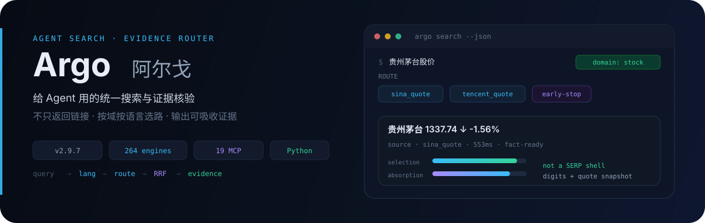
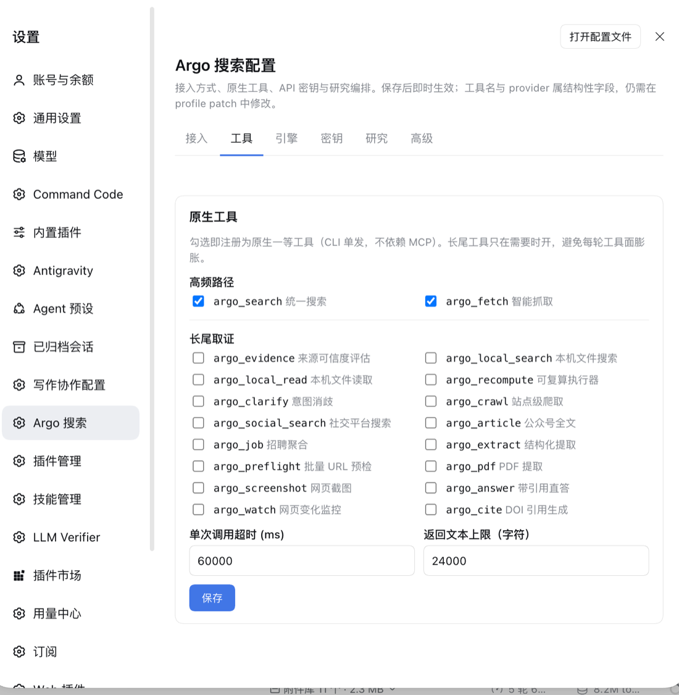
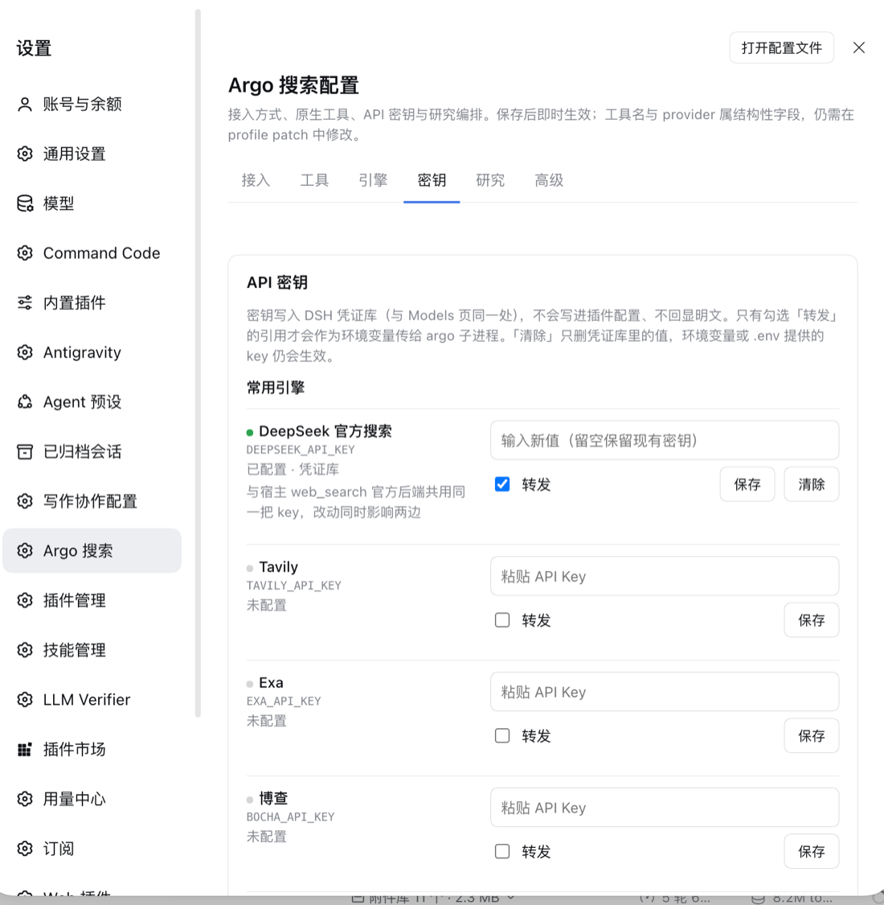

<p align="center">
  
</p>

<p align="center">
  <a href="README.md">中文</a> ·
  <strong>English</strong> ·
  <a href="README.ja.md">日本語</a> ·
  <a href="README.ko.md">한국어</a> ·
  <a href="README.es.md">Español</a>
</p>

<p align="center">
  <a href="#what-it-is">Intro</a> ·
  <a href="#why-its-stronger-than-built-in-search--ai-search--metasearch">Compare</a> ·
  <a href="#query-shaped-routing">Proof</a> ·
  <a href="#how-it-works">How it works</a> ·
  <a href="#quick-start">Quick start</a> ·
  <a href="#capabilities">Capabilities</a> ·
  <a href="#install--config">Config</a> ·
  <a href="#recent-updates">Recent updates</a>
</p>

<p align="center">
  
  
  
  
  
</p>

> **Part of the taxueseek DeepSeek Harness plugin lineup** ([dsh-files](https://github.com/taxueseek/dsh-files) 39★). Same-author skill series: [session-digger](https://github.com/taxueseek/session-digger) 29★ · [taxue-invest](https://github.com/taxueseek/taxue-invest) 21★ · [taxueskills](https://github.com/taxueseek/taxueskills) 23★ · [taxue-creative-style](https://github.com/taxueseek/taxue-creative-style) 12★

# Argo: search and deep research for agents

## What it is

**Argo is a search and deep-research tool that lives inside your agent, and can also pull information from the relevant web pages. It connects to 271 search sources across 97 business domains, and also covers basic local file search. Among open-source search projects, its search capability is exceptionally strong.**

API keys are optional and improve quality (keyed sources are usually better; unkeyed ones are skipped automatically), with free engines and local engines as an automatic fallback. It covers 18 languages including Chinese, English, Japanese and Korean, and supports vertical scenarios such as finance, academia, film, sports, code and macro data.

## Sub-skills

Argo's capabilities are organized as four sub-skills, each a standalone pipeline:

| Sub-skill | Capability |
|-----------|------------|
| **local-search** | Local file search + local zero-cost aggregation engines (32 local engines). Search code symbols, filenames, document text and file structure. Can merge into web search results: flip one switch and local hits join the same search |
| **local-seek** | Local semantic search (BM25 + vector hybrid) for notes, memories and knowledge bases. Three layers: locate the file, read the context, then read the passage closely |
| **ego-search** | Logged-in professional search. Content behind logins on Zhihu, Xiaohongshu, WeChat public accounts and similar, searched with a real browser and a logged-in session. Off by default; turn it on when needed |
| **js-run** | Run web JS without a browser. Run environment-probe and pure-compute page scripts without opening a browser; median single-run context is about 1ms |

Together the four cover the full chain from local machine to open web to behind login walls. Most cases need only local-search plus web search; turn on ego-search and js-run for special cases.

## DSH plugin

Argo is also a DeepSeek Harness plugin. One line installs it:

```bash
dsh plugin --profile web add "github:taxueseek/argo"
```

Restart `dsh web` and it takes effect. Search and fetch become native first-class tools: no MCP connection, no standing context overhead. There is also one `wide_research` parallel researcher and 19 MCP tools you can enable on demand. See integration forms below.

### Three invocation channels, one capability set

The same argo retrieval core (same engines, same compression, same guards) opens three channels inside DSH. They degrade automatically by host capability and back each other up:

| Channel | Default | What it does |
|---------|---------|--------------|
| **Native first-class tools** | On | `argo_search` / `argo_fetch` and friends register via `ctx.tools.register` and run as CLI single-shots (`--call`), reusing the exact engine and guard stack MCP uses — **no MCP connection, zero standing token overhead** |
| **Native web seam** | On | Registers `argo` as both a search and a fetch provider, so the host's built-in `web_search` routes to argo's engine chain and `web_fetch` to argo's fetch chain (HTTP first, auto-escalating to an anti-detection browser on Cloudflare / JS-rendered pages) |
| **MCP form** | On demand | The full 19-tool `mcp__argo__*` surface. Tool definitions are injected into context every round and survive compaction (measured ≈3.7K tokens/round for 19 tools), and the hot path is already covered by native tools and the web seam — so it is not mounted by default. Uncomment the `mcp-argo` line in the profile patch when you need the long-tail forensics tools |

There is also one `wide_research`: it plans complementary tracks (`depends_on` staggers them, parallel by default) → bounded concurrent subagent evidence gathering → a source ledger (only http(s) URLs are recorded) → a synthesis report. Output carries `quality_gate_results` (`conclusion_cap`: low/medium/high); when `passed=false` the wording is downgraded and the ledger sources are verified before any conclusion. The worker evidence-tool allowlist writes both MCP and native tool names (allow semantics), so it works whether or not MCP is mounted: with MCP it uses the full surface, without it falls back to `argo_search` / `argo_fetch` and the host's `web_search` / `web_fetch`.

For an everyday question use `argo_search`; for single-agent forensics use `argo_research`; for multi-perspective comparison with a citation ledger use `wide_research`. Workers can only call argo evidence tools by default and cannot call `argo_research` again (hard guard — user-level overrides do not work).

### Built-in settings page: six sections, effective on save

The plugin ships a browser-side settings page with two entries: the settings popup (`Cmd+,`) left-hand menu item "Argo", or Settings > Plugins > Argo (a summary card for the same panel — click to open).

<p align="center">
  
</p>

<p align="center">
  
</p>

| Section | What it controls |
|---------|------------------|
| **Access** | `web_search` / `web_fetch` seam toggles; engine entry command and args (npx or local `mcp_server.py`); search/fetch timeouts, body cap, idle connection reclamation, concurrent connections |
| **Tools** | Toggles for the 18 native first-class tools (only `argo_search` / `argo_fetch` on by default); per-call timeout and returned-text cap |
| **Engines** | argo's own behaviour switches (formerly env vars, curated allowlist of 28: cache / TF-IDF rerank / numeric cross-check / MinHash dedup / SERP guard, Jina / mobile UA / Parallel fetch layer, semantic evidence layer, hedge grace and tail width, engine enable list, proxy, local search roots and read allowlist, warmup / usage log / connection pool / assorted TTLs). Switch-type changes apply immediately; number / text / list types save as a group; unconfigured rows show argo's default and are marked "default". Authorisation switches (recompute, intranet URLs) deliberately stay out of the panel |
| **Keys** | Set, update and clear common engine keys; shows "configured / unconfigured + source layer (credential store / startup env / .env) + read-only state", never echoing plaintext; each row has a Forward checkbox, equivalent to adding the reference name to `keyRefs` |
| **Research** | worker / track / sources-per-track / token caps and report output directory |
| **Advanced** | worker tool allow / deny lists, credential forward list |

Saving takes effect immediately (all volatile config): the native tool set is registered and unregistered per the toggles, timeouts / concurrency / research caps are read on the next call; engine switches are written as `argoEnv` (one `KEY=VALUE` per line) into the argo subprocess env and apply to the next new connection (pooled old connections are reclaimed by `searchIdleMs`, default 60s). Structural fields (`toolName`, `provider`, `searchProviderId`, `fetchProviderId`) are not in the settings page — they still go through the profile patch and need a restart.

**Key security**: keys are written to the DSH credential store (the same place as the Models page) — never into plugin config, never logged, never echoed. Credential resolution priority is **stored file layer > startup env > project .env > home .env**: saving in the panel (or the Models page) overrides older startup-env values, and the argo subprocess picks up the new key on the next new connection; Clear only deletes the credential-store value, so keys supplied by env vars or `.env` reappear. The settings page is only a write entry for the credential domain — reads are still performed by the host on every call.

**DeepSeek official key, supplied natively**: argo's `deepseek_search` engine (the official `api.deepseek.com/v1/tools/search`, whose results carry authority levels / rerank scores / publish times) **shares one key with DSH's official search backend**. The plugin obtains it through DSH's native credential seam, so no manual configuration is needed: resolution is `ctx.get('credentials').resolve('DEEPSEEK_API_KEY')`, resolved per call — after rotating the key on the web Models page the next new connection uses it, with no plugin restart. The plugin never reads key files, never writes to disk, never logs; the key value reaches the argo subprocess env in memory only, and no output or error message contains it. On older hosts without a credentials service it silently skips: that engine is disabled for lack of a key, and the other 263 sources are unaffected.

**The web seam pin is required reading** (a missing pin breaks `web_fetch`): the host `dsh-web` provider selection rule is "configured id wins; if none is configured and exactly one is available, pick it; **if more than one is available, fail with `WEB_PROVIDER_AMBIGUOUS`**". The web profile ships an official http fetch provider by default (keyless, always available), and this bundle registers another — so without a pin there are two available and **`web_fetch` breaks entirely** (same for `web_search` if the profile has another search provider). Any profile with the web seam enabled must therefore specify explicitly on the web service line:

```yaml
- id: web
  config:
    searchProvider: argo    # required when the search seam is enabled (it is by default)
    fetchProvider: argo     # required when the fetch seam is enabled (it is by default)
```

`searchProviderEnabled: false` / `fetchProviderEnabled: false` turn the corresponding seam off entirely (the provider is still registered but not selectable, and the other is unaffected). On the engine side, anonymously usable engines such as Firecrawl work **keyless out of the box** (free-tier quota), engines with a configured key automatically upgrade to authenticated requests, and a missing key does not block routing.

> Full configuration options, the Compatibility version table and uninstall steps are in [packages/dsh-plugin/README.md](packages/dsh-plugin/README.md).

## Core strengths

**271 sources, 235 keyless and ready out of the box.** Runs without any API key; free and local engines fall back automatically. Keyed sources are usually better, and unkeyed ones are skipped automatically. One install covers every scenario.

**Local and web search in one.** This is a capability only Argo has. Local file search is built on the same tools developers use daily, rg and mdfind: code symbols, filenames, document text and file structure. Flip one switch and local hits join the same web search results, labelled with the local file as the source. When you remember writing something six months ago but forget where, this beats digging through folders.

**Two-layer cache, ~10ms for hot queries.** For content whose freshness matters less (encyclopedia entries, historical data), the first query populates the cache and the same query then hits it directly instead of going through the API again. Saves money and time.

**Multilingual and vertical.** Tested across 18 languages; Chinese, English and Japanese reach local first-party sources. Papers go to academic databases, film to title databases, code to Q&A communities, market quotes to financial sources. Only broad questions go to generic search.

## Install and run

Zero config works. Three ways to install, pick your habit:

**Want your AI assistant to search on its own**: install the skill package into its skills directory. Then when you say "look this up" or "verify this", it goes and searches.

**Want to try it casually**: one npx command, no install needed.

**Want it always on**: attach it over MCP, 19 retrieval tools ready. There is also a one-command injector that configures Claude Code, Cursor and Windsurf automatically; Codex, OpenCode and Cline are on the list too. Your config is backed up before writing, so you can always roll back.

```bash
# Option 1: install script (recommended for long-term local use)
curl -fsSL https://raw.githubusercontent.com/taxueseek/argo/main/scripts/install.sh | bash

# Option 2: npx on demand (recommended for quick agent attachment)
npx -y github:taxueseek/argo

# Option 3: git clone (development / editing source)
git clone https://github.com/taxueseek/argo.git
```

Try one query right after install:

```bash
argo search "python asyncio error handling"
```

What you get is questions from StackOverflow's official API, ranked by community score and marked with accepted status, not a pile of SEO farms.

To see how many sources are available on your machine right now:

```bash
argo search --list-engines
```

## Integration forms

Argo supports four integration forms; pick by scenario:

| Form | Best for | Notes |
|------|----------|-------|
| **MCP Server** | Always-on agent attachment | 19 retrieval tools ready; one command injects Claude Code / Cursor / Windsurf / Codex / OpenCode / Cline, config backed up first |
| **DSH plugin** | DeepSeek Harness users | One line `dsh plugin add`; search and fetch become native first-class tools, no MCP connection, no standing context overhead; ships a six-section settings page effective on save |
| **Skill files** | Claude Code / Grok Build / Kimi, etc. | Drop the skill package into the agent's skills directory; say "look this up" or "verify this" and it searches |
| **npx on demand** | Quick trial | `npx -y github:taxueseek/argo`, no install, good for temporarily attaching MCP to any client |

All four forms run the same Python code underneath; CLI and MCP tools map one to one, so no form lacks capability.

## Why it's stronger than built-in search / AI search / metasearch

> In short: the first three help **people** find information. Argo helps **agents** search and verify in one pipeline. The difference is the deliverable: a summary page or link list for humans vs ranked, reviewable, context-safe evidence for agents.

<p align="center">
  
</p>

| Dimension | Model built-in search | AI search (summaries) | Metasearch / engines | **Argo** |
|-----------|----------------------|------------------------|----------------------|----------|
| Result shape | Stitched long text | Human summary page | SERP link list | **Compact JSON: evidence candidates + credibility breakdown** |
| Vertical questions (quotes / formulas) | Generic web | Generic web then summarize | Generic web | **Direct vertical sources, answer-shaped** |
| Evidence credibility | No score | No structured score | No score | **selection · absorption · freshness · consensus** |
| Repeat queries | Hit the network every time | Hit the network every time | Page cache | **Two-layer cache (memory + SQLite); hot queries ~10ms** |
| Cost control | Uncontrollable | Expensive per call | Free but laborious | **Budget modes; free first; keys all optional** |
| Multilingual | Follows the model | Follows the model | Follows the engine | **Language detect + engine locale params + multilingual routing** |

> Mechanically, Argo treats search as an **evidence pipeline**: language detect → domain route → multi-engine recall → RRF fuse → evidence skim. The output is material an agent can rank, `fetch` to verify, and keep inside context.

---

## What changed in search by 2026

1. **From links to evidence.** Agents need structured material they can rank, verify and fit in context — Argo returns credibility-decomposed JSON, not SERP lists.
2. **Context is the first cost.** A single page scrape can burn 10k+ tokens; Argo's agent profile is ~3.7KB per call, with field sets and byte budgets pinned by gates.
3. **Sites now prepare content for AI.** llms.txt and `.md` direct-out are spreading across major doc sites — Argo's fetch chain probes them at level 0, with an r.jina.ai reader fallback.
4. **The free/open ecosystem is enough.** Government, academic, standards and security open APIs plus keyless engines cover most domains (235 keyless sources).
5. **Quality is measurable.** Ranking golden floors, fusion-ablation gates and negative routing controls — "is this version better" is now a number, not a vibe.

> v2.9.3 ships all of the above: 264 sources, 95 domains, 227 keyless. Details in [docs/为什么选择argo.md](docs/为什么选择argo.md).

---

## Query-shaped routing

<p align="center">
  
</p>

| You ask | What tends to happen |
|---------|----------------------|
| python asyncio error handling | Coding-QA domain → StackOverflow/StackExchange official API, with score & accepted-answer markers |
| AAPL / US pre-market | US equities domain, split from A-shares |
| 肖申克的救赎 主演 / Inception director | Film domain → IMDb etc. |
| 梅西 俱乐部 / 库里 球队 | Sports domain → TheSportsDB etc. |
| 埃菲尔铁塔在哪 / where is Eiffel Tower | Geo entity → OpenStreetMap etc. |
| NASA founding year / 国务院职能 | Org entity → Wikidata etc. |
| 周杰伦 专辑 / Taylor Swift album | Media domain → iTunes etc. |
| アニメ おすすめ / 한국 영화 추천 | Detect JA/KO → language-friendly sources; avoid Chinese-only sites |
| US CPI, Japan inflation | Macro domain; country split (national authoritative sources first) |
| log4j CVSS / nodejs 22 end of life | Security → NVD official; lifecycle → endoflife.date |
| attention is all you need | Academic → arXiv/OpenAlex/CrossRef metadata with DOI links |
| 阿司匹林 分子式 | Chemistry → PubChem-style answers |
| TSMC valuation debate (deep research) | Sub-questions + parallel sources; verticals boosted |

---

## How it works

<p align="center">
  
</p>

```
query
  ├─ intent clarify (optional)
  ├─ query rewrite (optional; routing still sees original intent)
  ├─ language detect + language preference
  ├─ route (domain rules + TF-IDF + budget + lang supplements + hot-path cache)
  ├─ multi-engine recall (circuit breaker / negative cache / parallel)
  ├─ staged empty-result recovery (widen → same family/general → cross-lang; anti-pollution)
  ├─ RRF fusion + optional re-rank
  ├─ evidence skim (authority · density · freshness · consensus)
  └─ unified JSON (incl. engine_outcomes / recovery)
```

### Evidence scoring (short)

```
selection  ≈ domain authority; SERP / redirect shells ranked very low
absorption ≈ density of numbers / definitions / comparisons / disclosures
freshness  ≈ publish time (ignores historical comparison years like “since 2015”)
composite  ≈ 0.40·selection + 0.35·absorption + 0.15·freshness + 0.10·engine score
```

Results include `selection`, `absorption`, `credibility_fast`, `evidence_flags`, etc. so agents can sort directly.

### Agent discipline (recommended)

1. **High-stakes questions** (positions, safety, “is this true?”): search → read fast scores → `fetch` top hits → then conclude  
2. **Numbers**: state the计算方式 (definition/scope); when sources conflict, list them—don’t force a merge  
3. **SERP / redirect pages**: never treat as primary sources  
4. **Social posts**: sentiment and narrative, not ground truth  
5. **Fact-check**: prefer a few stratified queries (source / comparison / subject)

---

## Quick start

Pick any path. **GitHub is the only install source of truth** (`npx github:taxueseek/argo` or `install.sh`); current recommendation **v2.9.7**. **Do not `npm install argo-search`** — the npm registry copy is an **unofficial stale v1.0.1** (not this repo, incomplete, not updated). This package sets `private: true` so it is not published to npm by mistake.

**Zero-config works**: without API keys, free engines + local `local_*` engines run; keyed engines are skipped when missing (and usually better when present).

### Option 1: Install script (best for long-term local use)

```bash
curl -fsSL https://raw.githubusercontent.com/taxueseek/argo/main/scripts/install.sh | bash
```

Custom home + Skill link:

```bash
curl -fsSL https://raw.githubusercontent.com/taxueseek/argo/main/scripts/install.sh \
  | bash -s -- --home "$HOME/.local/share/argo" --link "$HOME/.claude/skills/argo"
```

Verify:

```bash
python3 ~/.local/share/argo/scripts/search.py "python asyncio error handling" --json
python3 ~/.local/share/argo/scripts/search.py --list-engines
```

### Option 2: MCP from GitHub (fast agent attach)

Needs **Node.js 18+** and **Python 3.9+**. Once:

```bash
pip3 install pyyaml
```

```bash
npx -y github:taxueseek/argo
```

Client config (Claude Code / Cursor / Kimi, etc.):

```json
{
  "mcpServers": {
    "argo": {
      "command": "npx",
      "args": ["-y", "github:taxueseek/argo"]
    }
  }
}
```

More stable, no Node: install via Option 1, point at local Python:

```json
{
  "mcpServers": {
    "argo": {
      "command": "python3",
      "args": ["/path/to/argo/scripts/mcp_server.py"]
    }
  }
}
```

Unusual Python path: `export ARGO_PYTHON=/path/to/python3` (read by the npx entry only).

### DeepSeek Harness one-line plugin

Two install paths inside DeepSeek Harness:

```bash
# A: 19 mcp__argo__* tools (main-package bundle, same as full MCP)
dsh plugin --profile web add "github:taxueseek/argo"

# B: search tools + wide_research parallel research orchestration (subpackage)
dsh plugin --profile web add "github:taxueseek/argo#main&path:packages/dsh-plugin"
```

Restart `dsh web` after install. See `packages/dsh-plugin/`.

### Option 3: git clone (dev / patch source)

```bash
git clone https://github.com/taxueseek/argo.git
cd argo
pip3 install pyyaml
bash scripts/install.sh --link ~/.claude/skills/argo   # optional
python3 scripts/search.py --list-engines
```

---

## Platforms

| Platform | Integration | Notes |
|----------|-------------|-------|
| **Claude Code** | MCP / Skill link | `npx` or `mcp_server.py`; `link_source.py` ok |
| **Kimi / Grok Build** | MCP Server | same |
| **Cursor / Cline / Continue** | MCP | any MCP-capable IDE plugin |
| **CLI** | `search.py` / `bin/argo` | scripts, cron, manual debug |
| **Python projects** | `from search import super_search` | library call |

### Post-install check

```bash
python3 --version          # 3.9+
python3 -c "import yaml; print('PyYAML OK')"
python3 -m pytest tests/test_unit.py -q   # optional
python3 scripts/search.py --list-engines
```

---

## Capabilities

| Capability | What it does | Entry |
|------------|--------------|-------|
| Unified search | route → recall → fuse → skim score | `search.py` / `argo_search` |
| Local file search | on-disk code/notes/memory (offline) | `argo_local_search` |
| Local text preview | whitelist-dir preview (fail-closed) | `argo_local_read` |
| Recompute | sandboxed numeric recalc (deny by default) | `argo_recompute` |
| Deep research | sub-questions, multi-source, gap hints | `research.py` / `argo_research` |
| Credibility | authority / density / freshness / cross-check | `evidence.py` / `argo_evidence` |
| Intent clarify | polysemy, brand collisions, strategy hints | `clarify.py` / `argo_clarify` |
| Page fetch | HTTP first, browser fallback when needed | `argo_fetch` (`mode=extract` for structure) |
| Screenshot / PDF | page shots, structured PDF extract | `argo_screenshot` / `argo_pdf` |
| Site crawl | list-page batch crawl | `argo_crawl` |
| Query operators | `site:` / `-site:` / `-term` / `-"phrase"` / `"phrase"` / `lang:` / `after:` / `before:` stripped from routing and retrieval (details in references/usage.md) | write directly in the query |
| Trust signals | `authority_level` discrete grade (0-4, >=3 highly authoritative) + `summary` agent-grade digest (backfilled after verification) | result fields, visible via `--fields agent` |
| Social / sentiment | Weibo / Xiaohongshu / Bilibili / Reddit / X … | `argo_social_search` |
| DSH native tools | once installed as a DSH plugin, `argo_search` / `argo_fetch` and friends become first-class host tools running as CLI single-shots with zero standing token overhead | call directly after `dsh plugin add` |
| DSH web seam | the host's built-in `web_search` / `web_fetch` route to argo's engine and fetch chains (HTTP first, auto-escalating to a browser on Cloudflare / JS-rendered pages) | registered by default by the plugin; pin `searchProvider` / `fetchProvider` in the profile |
| DSH settings page | six sections — Access / Tools / Engines / Keys / Research / Advanced — effective on save; keys go to the host credential store and are never echoed | settings popup `Cmd+,` → left menu "Argo" |

### Budget modes

| Mode | Best for | Behavior |
|------|----------|----------|
| `fast` | simple Q, need speed | free engines first; skip paid re-rank |
| `auto` | daily default | cost-aware quality/spend tradeoff |
| `deep` | research, surveys | quality first; more engines allowed |
| `budget` | tight quota | quota control; degrade when exhausted |

### Rough capability set (v2.9.7)

What Argo does, in one sentence: it sends each question to the right sources by domain and language, ranks what comes back by credibility, and hands the agent material it can sort and verify. Search, fetch, evidence checking and local file search share one pipeline, the 19 MCP tools map one-to-one onto CLI commands, so nothing is missing whichever form you install. A few standalone commands round it out: argo tweet packs an X post, argo auth handles login state, argo job aggregates job listings. The full catalog, with cost, key and status per source, sits in docs/ENGINE_CATALOG.md: **271 sources (235 usable with no key), 97 domains**.

Installed as a DSH plugin, these capabilities become native host tools: the hot-path search and fetch are on by default, the long-tail forensics tools toggle on in the settings page, and argo's own 28 behaviour switches (cache, rerank, dedup, guard, proxy, TTLs and the rest) moved out of environment variables and into the panel. Keys go into the host credential store, are never echoed, and every change takes effect on save.

The last few releases each fixed one class of problems.

v2.9.7 fixed three long-standing ones. When an AI inside a DSH host asked to read a URL, the host used its own fetcher, so short-link redirects and JS challenge pages often failed outright while argo's fetch chain sat unused; this release wires the host's reads through argo, and those pages go from failing to succeeding, with static pages unchanged. The routing candidate pool used to hold 18 explicit-only engines, and if one was ever auto-selected the only paid engine would quietly bill you; the pool is clean now, and using them requires saying so. Every engine success used to take a file lock and rewrite breaker state on disk; healthy engines now cost zero file I/O, and multi-engine accounting commits in one transaction. The license also moved from MIT to Apache-2.0, which sits easier with commercial users.

After that the DSH plugin gained another layer: the settings page grew from five sections to six, the new "Engines" section brings argo's behaviour switches into the panel (they used to be env-var only), the keys page now shows whether each key comes from the credential store, the startup environment or `.env`, and tool toggles, timeouts, concurrency and research caps all apply on save. Cancellation now reaches the connection-establishment stage too — when the AI stops mid-flight, an argo subprocess that is still being spawned is killed immediately instead of waiting out its timeout.

v2.9.6 handled query operators and the transport layer. A query like site:github.com foo used to have its operator treated as a plain word, or parsed but never applied; a contract layer now strips operators before routing and caching, applies site: as a real filter, and folds it into the cache key, so two searches don't bleed into each other. On transport, every POST used to re-pay the TLS handshake, 320 to 561 ms of it; with connections pooled, a resident MCP process saves that on every query. This release also added the official DeepSeek search engine, billed per call and kept out of the everyday combos.

v2.9.5 added FX rates and tightened dedup. Asking for the USD/CNY rate used to spin through the macro domain and land on an encyclopedia entry, 1.4 s with no answer; a dedicated fx domain now answers in 675 ms with the live rate and daily news. Dedup gained site-suffix normalization and a fuzzy second pass, so official docs with separators in the title stop getting pushed to the back.

v2.9.4 fixed the explicit-engine path. Pinning --engine X used to get a blanket cache TTL; with domain determination in place, the TTL follows the domain, and a missing fallback engine no longer triggers an empty re-run of the same engine.

Per-version detail lives in "Recent updates"; release notes for each version are in docs/.
---

## Engines & routing

Config currently has **271** sources (**235** usable with no key) and **97** domains (see `config.yaml` and `--list-engines`).

### Direct & vertical (excerpt)

| Engine | Scenario | Cost bias |
|--------|----------|-----------|
| anysearch / duckduckgo | general / tech | free |
| sina_quote / tencent_quote / eastmoney | A-share quotes / flows | free |
| finviz / seeking_alpha | US & overseas finance | depends |
| imdb / itunes / thesportsdb | film / music / sports | mostly free |
| local_openstreetmap / wikidata / wikipedia | geo / org / encyclopedia | free |
| arxiv / semantic_scholar / openalex | academic | mostly free |
| pubchem / gbif / rfc_editor | chemistry / species / standards | free |
| github / stackoverflow / pypi / npm | code & packages | depends |
| byted / bocha / metaso / octen | Chinese web / AI search | API / low cost |
| zhihu / wechat_sogou | Chinese opinion / WeChat | API / free |
| tavily / felo / exa | international / semantic | paid or quota |
| twitter / reddit / xiaohongshu / bilibili / weibo | social UGC | free (some need login) |

### Local zero-cost layer (`local_*`)

No separate SearXNG service. Main path uses in-process HTML / RSS / JSON parsing (`local_bing`, `local_sogou`, `local_google`, `local_arxiv`, …). For **multilingual queries**, routing rewrites engine language params (e.g. Bing `setlang`) and fuses with RRF.

---

## Examples

### Finance

```bash
python3 scripts/search.py "python asyncio error handling" --explain
# typical: stock_query → quote snapshot sources
```

### Academic

```bash
python3 scripts/search.py "transformer attention mechanism paper" --json
# domain often academic; combo includes arxiv etc.
```

### Research & verify

```bash
python3 scripts/research.py "2026 mutual fund Q2 holdings structure" --depth deep --json

python3 scripts/search.py "same query" --json | \
  python3 scripts/evidence.py "same query" --stdin --json
```

### MCP tools (12)

| Tool | Purpose |
|------|---------|
| `argo_search` | unified search |
| `argo_local_search` | local files (offline) |
| `argo_local_read` | whitelist local text preview (fail-closed) |
| `argo_recompute` | sandboxed recalc (deny by default; needs auth) |
| `argo_research` | deep research (incl. social-sentiment mode) |
| `argo_evidence` | credibility scoring |
| `argo_clarify` | intent disambiguation |
| `argo_fetch` | smart fetch (`mode=extract` structured extract) |
| `argo_crawl` | site crawl |
| `argo_screenshot` | page screenshot |
| `argo_pdf` | PDF extract |
| `argo_social_search` | multi-platform social (`mode=sentiment`) |

---

## Install & config

### Requirements

| Item | Requirement |
|------|-------------|
| Python | 3.9+ (CLI + MCP core) |
| Deps | `pip install pyyaml` (only hard dependency) |
| Node.js | **only** for `npx` entry, 18+ |
| SearXNG | not required (built-in local engines) |

### API keys (all optional)

Missing keys skip that engine; free engines backstop. **Use env vars**—never commit real keys or paste them into issues.

```bash
# recommended (better quality)
export TAVILY_API_KEY="your_key"
export BOCHA_API_KEY="your_key"
export METASO_API_KEY="your_key"
export ZHIHU_ACCESS_SECRET="your_key"

# optional
export BRAVE_API_KEY="your_key"
export FELO_API_KEY="your_key"
export GITHUB_TOKEN="your_key"
export WEB_SEARCH_API_KEY="your_key"
export ANYSEARCH_API_KEY="your_key"
export OCTEN_API_KEY="your_key"
export ARGO_KEENABLE_API_KEY="your_key"   # optional; Keenable free trial
```

`config.yaml` only stores `{ENV_NAME}` placeholders—no plaintext secrets in git.

### Cache

Default SQLite path is `cache.db_path` in `config.yaml` (usually `~/.cache/unified-search/cache.db`).

| Type | Approx. TTL |
|------|-------------|
| Finance | ~5 min |
| News / realtime | ~10–15 min |
| General | ~1 hour |
| Research / evergreen | ~2–24 hours |
| Empty results | very short (avoid freezing “no hits”) |

### FAQ

**Works without API keys?**  
Yes. Many local free engines and free APIs; unkeyed path is automatic.

**Install script vs npx?**  
Script: fixed local install, config, Skill link. npx: attach MCP fast. Same Python core.

**How to check engines?**  
`python3 scripts/search.py --list-engines`, or add `--explain`.

**Multiple code copies in the repo?**  
No. Prefer one source + symlinks via `link_source.py`, not rsync clones.

---

## CLI flags

```
python3 scripts/search.py [options] query

  --engine, -e       engine, default auto
  --max-results, -n  count, default 5
  --depth, -d        fast | balanced | deep
  --mode             fast | auto | deep | budget
  --no-cache         skip cache
  --explain          print routing explanation
  --json             JSON output
  --timeout, -t      timeout seconds
  --list-engines     list engines
```

---

## Design trade-offs

1. **Agent absorption first, link count second.**  
2. **Free and local first; paid is optional lift.**  
3. **Failures are observable**: empty / timeout / breaker are labeled—no silent swallow.  
4. **Config-driven engines**; `config.yaml` is the single source of truth.  
5. **Single-source install**: link entries, don’t rsync copies.  
6. **Social is not a truth library**; good for expansion and sentiment, not sole ground truth.

---

## Good fits

- Search backend for Claude Code / Grok Build / Codex / Kimi agents  
- **Multilingual, multi-domain** Q&A: CJK + EN + finance / film / sports / academic / code  
- Scripts and pipelines that need **reproducible, cacheable** retrieval  
- Fact-check and multi-source comparison of public finance / entity data  

Not a great sole solution for: platform-native engagement ranking, or long-lived max-recall aggregators (embedded local engines replace external SearXNG as the main path).

---

## Tree (short)

```
argo/
├── README.md                # Chinese (default)
├── README.en.md             # English
├── README.ja.md             # Japanese
├── README.ko.md             # Korean
├── README.es.md             # Spanish
├── SKILL.md
├── package.json             # npx entry
├── bin/argo.js              # Node MCP launcher
├── bin/argo                 # Python CLI
├── config.yaml              # engines & domains (source of truth)
├── assets/readme/           # README visuals
├── backends/
├── mcp/                     # MCP client inject source (clients.yaml)
├── scripts/                 # search / research / mcp / install …
├── sub-skills/local-search/
├── sub-skills/ego-search/      # logged-in professional search (off by default)
├── tests/
└── docs/
```

---

## Recent updates

### Unreleased (DSH plugin): settings page gains an "Engines" section + cancellation reaches connection establishment

- **Sixth settings section "Engines"**: argo's 28 behaviour switches moved out of environment variables and into the panel (cache / TF-IDF rerank / numeric cross-check / MinHash dedup / SERP guard, Jina / mobile UA / Parallel fetch layer, semantic evidence layer, hedge grace and tail width, engine enable list, proxy, local search roots and read allowlist, warmup / usage log / connection pool / assorted TTLs). Applied via the new volatile config `argoEnv` (one `KEY=VALUE` per line) into the argo subprocess env; names go through the `ARGO_ENV_SPECS` allowlist, and anything outside it fails loudly at apply time so a typo cannot silently do nothing. Switch-type changes apply immediately; number / text / list types save as a group; unconfigured rows show argo's default and are marked "default". Authorisation switches (recompute, intranet URLs) deliberately stay out of the panel
- **Key source layer is now visible**: shows "configured / unconfigured + source layer (credential store / startup env / project .env / home .env) + read-only state", with non-file layers noting they will be overwritten on save; `DEEPSEEK_API_KEY` is marked as shared with the host's `web_search`; `fetchMaxChars` is truncated to the argo tool schema cap of 50000 on save, removing the "displayed value ≠ effective value" mismatch
- **Cancellation reaches connection establishment**: `acquireMcp` now honours cancellation while the connection is being established — abort kills the subprocess and settles with `WEB_ABORTED` instead of waiting out the timeout; cancellation also flows through the single-shot fallback
- **Fixes**: evidence dedup no longer swallows case; older hosts without `effect` no longer crash activation; `saveKey` / `setForward` / `toggleTool` read a live snapshot, fixing a race that dropped updates on rapid consecutive actions; `describe` responses are guarded against reordering, only the latest request's response is accepted

### v2.9.7: Architecture consolidation — DSH web_fetch seam + explicit_only contract + unified state contracts (License: Apache-2.0)

- **License change**: MIT → Apache License 2.0 (explicit patent grant, safer for commercial use); nothing else changes
- **DSH plugin web_fetch seam**: the host's web_fetch used to bypass argo entirely as the default "read this URL" path; it now registers a fetch provider on the argo_fetch chain (HTTP first, auto-upgrade to an anti-detection browser on Cloudflare / JS-rendered pages); isomorphic dual-path execution with the search provider — resident MCP pool first, CLI single-shot only on transport failure, tool-level errors and timeouts are not retried (those mean the call already ran; retrying doubles engine calls and quota); failures classified into five kinds (timeout / blocked / empty / generic / cancelled) with actionable messages; new config `fetchProviderEnabled` / `fetchProviderId` / `fetchTimeoutMs` (25000) / `fetchMaxChars` (50000), all on by default with escape hatches; measured: cross-origin redirects (short links, protocol upgrades, redirect shells) and JS challenge pages flip from structural host failures to argo successes, static pages unchanged
- **explicit_only contract closure**: `config._routable_filter` filtered env blacklists / keys / blocklists but not explicit_only, so 18 explicit-only engines (including the only paid `deepseek_search`) sat in the enabled candidate pool where six routing paths (TF-IDF injection, catch-all, backfill, fallback, etc.) could select them — it never fired only because the corpus had no matching entry; one entry would have auto-fired paid engines in auto mode; now filtered at the single producer, locked by `tests/test_explicit_only_gate.py`
- **Unified state contracts**: circuit breaker memory short-circuit when healthy closed and zero-count (no file lock, no disk rewrite) with cross-process awareness via `(st_mtime_ns, st_size)`; adaptive accounting folds `MAX(created_at)` into one aggregate SQL plus a `batch()` context manager for single-transaction multi-engine commits; quota exhaustion records the credential fingerprint and auto-unlocks on key rotation; the route cache invalidates when a combo engine is exhausted or recovers; `is_engine_routable` becomes the single admission predicate behind backfill / tfidf / breaker_filter
- **Dispatch and transport**: auto / deep also drop hard-exhausted engines (fail-open fallback); hedge wait window narrowed, Wave-1 early stop now accepts cross-engine cumulative sufficiency; POST connection pooling (saves ~320ms anysearch / ~561ms octen per request) + MCP pre-connect; weather domain gains `early_stop_min_results: 1`
- **Sub-skill hot-path subtraction**: js-run replaces SIGALRM with MiniRacer's native timeout, fixing the `ValueError: signal only works in main thread` crash when called from crawl / research / mcp worker threads; local-seek rerank drops per-query O(N) disk reads; local-search reuses the registry (no double YAML parse); ego-search short-circuits probing under auto
- **Validation**: 71 plugin unit tests; full suite 4264 passed / 28 skipped; pre-commit seven gates 123 passed; fetch-chain A/B shows no static-page regression and failures flipped to successes on redirects / JS challenges

### v2.9.6: DeepSeek Search engine + query operator contract + transport connection pooling + routing snapshot gate

- New engine `deepseek_search` (official `api.deepseek.com/v1/tools/search`) on by default: auto-skipped without `DEEPSEEK_API_KEY`, other 265 sources unaffected; measured 445-510ms (anysearch 1.7-4.5s / exa 3.7s), the only one of the three with full authority tier / rerank_score / publish-time coverage, on par with anysearch for ja/ko/es; pay-per-use, excluded from domain combos, explicit `--engine deepseek_search` is the main path; DSH hosts share the same key with the official backend via the native credential seam (key rotation on the web Models page takes effect on the next hop, never persisted or logged)
- Fix: `--since/--until` silently ineffective for deepseek_search (added to TIME_CAPABLE_ENGINES)
- New `query_operators.py` query operator contract layer: `site:` / `-site:` / `-term` / `-"phrase"` / `lang:` / `after:` / `before:` converge from five scattered forms into structured operators; routing, cache, and query understanding only see the clean_query with instructions stripped; `site:` / `-site:` truly post-filter (subdomain match, multi-site OR, filtered count in `site_filtered`), operators join the result cache key to avoid cross-contamination
- `evidence.py`: new Agent-tier two-layer summary `summary` field (DeepSeek Search summary semantics)
- Transport de-duplicated pay: POST reuses pooled connections (measured second request on the same connection saves 320ms anysearch / 561ms octen), with borrow-failure retry and read-drain-before-return; MCP pre-connect; quota exhaustion and dead negative-cache closure
- Routing: octen joins the general fallback chain second slot and TF-IDF hedge slot (anysearch jitter window p90 3273→1614ms, max 6266→1928ms, errors 9→0; no median difference in the healthy window, positioned as tail insurance), `ARGO_GENERAL_FALLBACK_LEGACY=1` escape hatch
- Fix RRF caliber-isolation rank decay: all results from one engine scored identically (measured anysearch 5 results all 0.017213), output degenerated into engine-weight block concatenation; new test locks "strictly decreasing scores within the same engine"
- Fix Bing ck/a redirect shell not restored, causing the aggregation layer to filter entire batches (40.2% empty results in the last 7 days): offline base64url decode restores real links, zero network
- Fix TF-IDF leader combo producing `['anysearch','anysearch']` run twice concurrently (double quota with wasted_ms recorded as 0): 200 real queries replayed, duplicate combos 1→0
- Search improvements: failure negative cache, Nitter failover, caliber isolation, X Article extraction, query echo guard (early-stop rejection + recovery chain engine switch)
- Engineering: new `scripts/pre-commit` gate (static_lint / module_size_gate / usage_doc / consistency / routing_snapshot / context_budget + engine_catalog, ~12s measured); routing decision snapshot gate turns routing flips into diffable golden (union of three annotation sets, 115 queries, only domain and kind compared so environment noise can't false-red); caliber registry sync test locks "engine names in the table must be really registered"
- DSH plugin adapts to DSH 0.2.1-rc.2: dual-stack runtime entry (`startActivation({provider, label, request, signal, delivery})` new / `start(provider, request)` legacy), tool guard inside the plugin prevents worker nested `wide_research` calls after rc.2 removed `toolFilter`; end-to-end verified on rc.2 (`wide_research` planner → 2 workers → synthesis, passed=true / 14 sources) and native `argo_search` (count=3); 0.2.1-alpha.1 compatibility branch covered by unit tests; plugin unit tests 46→50
- DSH environment versions: **DSH 0.2.1-rc.2 (current, running, end-to-end verified) + DSH 0.2.1-alpha.1 (compatible, legacy start branch unit-covered)**; compatibility table in `packages/dsh-plugin/README.md`

### v2.9.5: FX-rate dedicated domain + two-layer dedup + ranking false-kill fix + per-checkout daemon isolation

- `config.yaml`: new `fx_query` domain — "RMB/USD exchange rate, central parity, offshore" queries no longer fall through macro-data dead-ends to encyclopedia entries; now live rate + daily parity news (675ms measured; previously 1411ms and off-target)
- `search_rank.py`: two-layer dedup — title site-suffix normalization (zero-dep) + rapidfuzz fuzzy near-duplicate check (only inside the near-hit band; `ARGO_DEDUP_FUZZY=0` to disable, auto-fallback to pure minhash when not installed)
- Fix: title separator false-kill during degraded rerank — titles containing `|` / `_` / `——` were uniformly ×0.6, pushing official docs down 40%; every auto/deep query on keyless setups was affected (judgment converged to the single rank_signals implementation)
- `query_understanding.py`: negation understanding gains "not-X" (the interrogative "whether" is not misread as negation)
- `daemon.py`: on-disk names (socket/pid/pointer/log) scoped per checkout — multi-worktree/clone daemon squatting, wrong-process kills, and "edits don't take effect" all rooted out
- New optional dependency rapidfuzz (`pip install rapidfuzz`; installed by install.sh, core unaffected when missing)

### v2.9.4: Explicit engine domain attribution + recovery chain circuit-breaker + gate sync

- `route.py`: explicit `--engine X` supplements `match_domains`, fixing cache TTL blanket-general
- `recovery.py`: explicit single-engine no-fallback skips L1 same-engine empty run
- `config.yaml`: `org_entity` adds unless shareholder-diligence terms; `fund_query` adds unless policy-regulation terms
- `mcp_launch.sh`: `set -a` narrowed to `. "$ENV_FILE"` single line
- `sub-skills/local-search/`: engine registry layer closure and search_v3 quality improvement
- Gate sync: module_size_gate / ENGINE_CATALOG / domain_profiles.json baseline aligned

### v2.9.3: full X post packaging + browser login-state lane + local-chain quality/speed fixes

- **New**: `argo tweet` — one command packs a given X post's full text, thread/quote/repost context and engagement data; text-only by default, `--out` writes a 4-file bundle (post.md/raw.json/manifest.json/CHECKLIST.md), `--media` downloads images/videos on demand; failure reasons surface in the artifacts
- **New**: `argo auth` browser login-state lane — `login/status/logout` manages a persistent per-site browser profile; scan the QR once and login-required pages become fetchable; cookies stay in Chrome's own encrypted storage (argo never reads or exports them), login-state results are flagged `login_state_used` and excluded from the shared cache (enable with `ARGO_AUTH_FETCH`)
- **More accurate**: the Chinese local chain resolves Sogou/Baidu redirect shells into real URLs without a session (kept results 1→5); intent-gate false-lock fixed ("tutorial"-style queries no longer pinned to one engine); rail table-row identity URLs fix the candidate funnel compression (10→1 → faithful 10→10)
- **Faster**: adaptive consensus grace (the first engine delivering enough releases the wait; English dispatch ~3.0s→2.2-2.5s); local long-tail early-stop; local image fingerprints via mmap matrix dot product (77k images 158ms→3.9ms, off by default with `ARGO_LOCAL_IMAGE=1`); automatic agent-consumption slimming + markdown content negotiation, MCP per-call fixed overhead −32%
- **More sources**: 43 engines without domain references wired into their domains; route_lang language routing; 3 new keyless finance sources; `--academic-deep` one-flag academic multi-source; rail transfer/stopover queries
- **More robust**: js-run wired in as the fetch chain's first lane (Chrome-fingerprint retries); jsrun session-leak and backoff-budget fixes; timeouts tightened (redskill 60→15s) with the declaration policy split into three groups

### v2.9.2: DSH 0.2.1-alpha.1 compatibility verified + routing/guard fixes + js-run sub-skill

- **More compatible**: the DSH plugin is verified on the latest DSH 0.2.1-alpha.1 — native first-class tools / web_search seam / wide_research all work; `argo mcp inject` adds WorkBuddy, covering a 7th host
- **More accurate**: TF-IDF weak-evidence demotion to auxiliary sources, dead-source floor + breaker slot backfill, quota-exhausted engine isolation, serp_guard false-positive fixes
- **Faster & more robust**: lazy imports for engines/evidence (import volume −50%), admission existence-set short-circuit (open calls 261 → 99), MCP entry/numeric-argument guards; new `sub-skills/js-run` sub-skill (browser-free JS execution, P50 ≈ 1ms)

### v2.9.1: content-quality optimization + content-farm resistance + latest-environment compatibility

- **Cleaner**: improved content-quality assessment and stronger resistance to content farms — low-quality, bulk-generated content in results is identified and filtered more effectively
- **More compatible**: adapted to the latest host environment for seamless operation
- **More stable**: local search now guards against its own install tree, so results are no longer polluted by argo's own source files

### v2.9.0: source optimization + plugin/CLI parity + minor languages

- **Broader**: sources 237 → 253 (keyless 198 → 219), adding 14 minor-language local news sources, the CORE open-access full-text source, TinEye reverse image search, a stable Bing RSS outlet, and more; the evergreen Baidu and Sogou sources were revived
- **More aligned**: 18 CLI commands map one-to-one to 19 MCP tools — plugin and CLI search capabilities are fully at parity for the first time
- **More languages**: 14 minor-language sources (Thai/Arabic/Hebrew/Greek/Hindi/Vietnamese/Turkish/Indonesian, etc.), matched automatically by query language
- **Faster**: import chain −79%, rerank at n=200 33ms → 1.5ms, cache hit rate from ~60% to almost no misses
- **More trustworthy**: cross-process safety fix on the quota write path, early-stop results no longer mislabeled as timeouts, and `argo stats` gives search quality its own ledger

### v2.8.9: slimmer output + richer and faster retrieval + 5 international media and fact-check sources

- **Leaner**: default output −66% (the same results are no longer written three times); repeated queries −30% (routing-decision cache); slow-network waits −36% (backup sources auto-dispatched when the primary stalls past 0.8s)
- **Richer**: recall +35%, fetch latency −30%; body-structure fidelity 0/6 → 6/6 (headings, lists and tables no longer flattened); Chinese content no longer systematically judged low-quality
- **New**: sources 235 → 237 (keyless 194 → 198, all free — The Guardian, France 24, DW, fact-checkers FactCheck.org / Full Fact in US and UK editions); dead source gdelt retired
- **More trustworthy**: six bookkeeping defects where numbers contradicted each other fixed; the six-stage funnel shows which layer a "0 results" collapse happened in; offline replay tools verify changes same-day; see [release notes](docs/RELEASE_NOTES_v2.8.9.md)

### v2.8.8: real-user bug fixes + across-the-board speedups + 235 sources

- **Fixes**: engines silently returning nothing after a key was configured under its recommended name (#12); the fetch chain bypassed proxies so GitHub etc. always failed (#13) — `ARGO_PROXY`, config per-domain rules and standard proxy environment variables now all work, and `NO_PROXY` is respected
- **Faster**: CLI cold start 2.1s → 0.55s; cross-process config cache 50–82ms → 16–18ms; every search reports per-stage timing and a budget bill, so there is no guessing where it is slow (`--no-timing` to disable)
- **New**: sources 218 → 235 (keyless 184 → 194, all keyless: domestic trending boards, security vulnerabilities, open-access scholarship, skill directories, agent search), `argo answer` direct answers, `argo watch` page watching, CLI/MCP tool-surface alignment
- **More robust**: platform-conventional paths on all three OSes (new `argo paths` introspection), Python 3.9 supported, silent degradations now reported; see [release notes](docs/RELEASE_NOTES_v2.8.8.md)

### v2.8.7: sources expanded to 218 + a batch of fixes

- **Source expansion**: 168 → 218 sources, 72 → 89 domains (new official sources incl. StackExchange Q&A, DOI metadata, vulnerability intel, product lifecycles), plus three direct-out fetch channels
- **A batch of fixes**: multi-engine routing, zero-result fallback, Chinese redirects, local search degradation, etc.; see [release notes](docs/RELEASE_NOTES_v2.8.7.md)

### v2.8.6: faster search + multi-source split

- Engine racing, Zhihu three-source split, language/academic dispatch widened, dead-source gate

### v2.8.5: native DSH plugin tools + MCP off by default + Windows support

- **Native plugin tools**: `argo_search` / `argo_fetch` register as first-class native tools, available by default without an MCP connection; schemas are generated from the single source of truth (`mcp_tools.py`), zero drift; all 18 tools (except `argo_research`) can be enabled via `nativeTools`
- **MCP off by default**: three plugin shapes (on-demand MCP / native tools as the default entry / web_search seam); zero standing token cost, and one profile patch opens the full 14-tool surface
- **Windows compatibility** (community PR #11): system temp paths, GBK encoding fix, runtime interpreter resolution (`python3`/`python`), symlink falls back to junction, new PowerShell installer `install.ps1`
- **Quota self-healing**: remote quota exhaustion hidden in HTTP 200 envelopes is detected; routing excludes that engine and switches to backup sources, returning automatically at the next quota period
- **Fetch global deadline**: `ARGO_FETCH_DEADLINE_S` (default 60s) caps the fallback chain; 429/503 stop signals are honored; tinyfish rendering + `.md` variant probes

### v2.8.4: local data fusion + one-command MCP attach

- **Deep research can eat your local data**: work packages can take `file_inputs` (first-hand CSV / XLSX / literature; hash registered, content not stored) + `recompute` (sandboxed recalculation; mismatches are flagged)
- **MCP attach is no longer hand-edited config**: `argo mcp inject` writes Claude Code / Cursor / Windsurf / Codex / OpenCode / Cline (atomic write + backup + undo)
- **Simple queries stay cheap**: query normalize + complexity gate + social/platform syntax first + if a Chinese engine is dropped, keep looking at backups
- **Keenable** added as a free-trial web search source
- **Security**: recompute blocks outbound subprocesses; host paths are install-aware

> Full notes: the table below and per-version [release notes](docs/).

---

## Changelog

| Version | Notes |
|---------|-------|
| **v2.9.7** | **Architecture consolidation + DSH web_fetch seam + License to Apache-2.0**: MIT → Apache License 2.0; host web_fetch now flows through the argo_fetch chain (HTTP first, browser upgrade on JS challenges, dual-path execution, no retry on tool errors, five-class failures); 18 explicit-only engines removed from the routing candidate pool (closes the accidental paid-engine billing hole); breaker health short-circuit, adaptive single-transaction accounting, quota auto-unlock on key rotation, route cache exhaustion invalidation; auto/deep drop hard-exhausted engines + wider early stop + POST connection pooling; js-run fixes the non-main-thread crash. |
| **v2.9.6** | **DeepSeek Search engine + query operator contract + transport connection pooling + routing snapshot gate**: new `deepseek_search` engine on by default (auto-skipped without key; 445-510ms, the only engine with full authority/rerank_score/publish-time coverage, time windows truly effective; DSH shares the key via the native credential seam); `site:`/`-site:`/`-term`/`lang:`/`after:`/`before:` converge into an operator contract layer with real post-filtering + cache-key join; POST connection pooling (saves 320-561ms per request) + MCP pre-connect; octen joins fallback and hedge slots (p90 3273→1614ms, `ARGO_GENERAL_FALLBACK_LEGACY=1` escape); fixes RRF rank decay and Bing redirect shell (40.2% empty results); new pre-commit gate and routing snapshot gate; DSH plugin adapts to 0.2.1-rc.2 dual-stack + alpha.1 unit coverage. |
| **v2.9.5** | **FX-rate dedicated domain + two-layer dedup + ranking false-kill fix + per-checkout daemon isolation**: new `fx_query` domain (rate/parity queries: live rate + daily news in 675ms vs encyclopedia before); dedup gains site-suffix normalization (zero-dep) + rapidfuzz fuzzy check (optional, `ARGO_DEDUP_FUZZY`, fallback); fixes separator ×0.6 false-kill (official docs back on top); negation gains "not-X"; daemon names scoped per checkout. |
| **v2.9.4** | **Explicit engine domain attribution + recovery chain circuit-breaker + gate sync**: `--engine X` supplements `match_domains` fixing cache TTL blanket-general; single-engine no-fallback skips L1 empty run; `config.yaml` domain rules enhanced (org_entity/fund_query unless terms); `mcp_launch.sh` env var export narrowed; local-search engine registry layer closure and quality improvement; gate sync. |
| **v2.9.3** | **Full X post packaging + browser login-state lane + local-chain quality/speed fixes**: new `argo tweet` (full text/thread/quotes/reposts/media packed on demand, `--out` 4-file bundle); new `argo auth` browser login-state lane (persistent per-site profile, cookies stay in Chrome's encrypted storage, login-state results excluded from the shared cache); Chinese local chain resolves Sogou/Baidu redirect shells session-free (kept 1→5) + adaptive consensus grace (English dispatch ~3.0s→2.2-2.5s); js-run wired as the fetch chain's first lane (Chrome-fingerprint retries); rail transfer/stopover queries (funnel 10→1 fixed to a faithful 10→10); `--academic-deep` one-flag academic deep-dive; 43 engines wired into domains + 3 keyless finance sources + intent-gate false-lock fix; local image fingerprints 158ms→3.9ms; agent-consumption slimming (MCP fixed overhead −32%). |
| **v2.9.2** | **DSH 0.2.1-alpha.1 compatibility verified + routing/guard fixes + js-run sub-skill**: the DSH plugin's three forms verified enabled on the latest DSH 0.2.1-alpha.1; `argo mcp inject` adds WorkBuddy, covering a 7th host; TF-IDF weak-evidence demotion to auxiliary sources, dead-source floor + breaker slot backfill, quota-exhausted engine routing isolation, serp_guard collateral false-positive fixes; engines/evidence lazy imports (import −50%) and admission existence-set short-circuit (open 261→99); MCP entry and numeric-argument guards tightened; new js-run sub-skill (browser-free web JS, P50 ≈1ms). |
| **v2.9.1** | **Content-quality optimization + content-farm resistance + latest-version adaptation**: improved content-quality assessment with better identification and filtering of low-quality bulk-generated content; adapted to the latest version for seamless operation; local search gained a self-install-tree guard so results are not polluted by argo's own source. |
| **v2.9.0** | **Source optimization + plugin/CLI parity + minor languages**: sources 237→253 (keyless 198→219), adding 14 minor-language news sources, the CORE full-text source, TinEye reverse image search, Bing RSS and more; Baidu and Sogou revived; 18 CLI commands map one-to-one to 19 MCP tools; import chain −79%, rerank 33ms→1.5ms, cache hit rate greatly improved; cross-process quota write-path safety fix; new `argo stats` local usage ledger. See [release notes](docs/RELEASE_NOTES_v2.9.0.md) |
| **v2.8.9** | **Output slimming + richer, faster retrieval + 5 international & fact-check sources**: default output 15.5KB→5.2KB (−66%, `--envelope` restores the full envelope); routing decision cache cuts repeated queries −30%; slow-network dispatch −36% (serial domains auto-hedge past 0.8s); five-round fetch-chain overhaul (recall +35%, fetch latency −30%, long-tail P90 −8%) + body structure restoration (headings/lists/tables fidelity 0/6→6/6) + CJK quality-score fix; new keyless sources Guardian RSS / France 24 / DW / FactCheck.org / Full Fact (235→237, keyless 194→198, domains 90→92), dead gdelt retired; six self-consistency defects fixed + six-stage funnel attribution + offline replay tool (`scripts/replay_eval.py`) + post-policy deployment gates & scenario-threshold contracts. See [release notes](docs/RELEASE_NOTES_v2.8.9.md) |
| **v2.8.8** | **Real-user fixes (#12 key-alias silence, #13 proxy-less fetch) + across-the-board speedups + sources 218 → 235**: unified egress dispatch (`ARGO_PROXY` / per-domain rules / standard proxy env, `NO_PROXY` respected); 16 key-read sites unified on the alias chain; command cold start 2.1s→0.55s, cross-process config cache 50–82ms→16–18ms, QPP flatness-gated early stop, `--list-engines --detail` slimmed 152KB→51KB; new `argo answer` (cited direct answers) and `argo watch` (webpage change watching), 14 keyless sources (CN trending & lifestyle / security advisories / open-access scholarship / skill directories / agent search), 69 engines re-classified (`web_general` fallback share 41%→20%, new security domain); platform-conventional paths (`argo paths`) + Python 3.9 + bounded concurrency making timeouts real; search.py split into modules 3351→2526 lines, relevance golden over 22 engines, static-defect & output-contract gates. See [release notes](docs/RELEASE_NOTES_v2.8.8.md) |
| **v2.8.7** | **218 sources / 89 domains + three fetch direct-out channels + routing trigger discipline + macro zero-result fix**: 50 new sources across batches 7/8/9 (statutes, standards, security intel, academia, news, entertainment, energy/transport, legal), stackexchange & doi engines; fetch chain level-0 llms.txt and `.md` variant probing plus r.jina.ai reader level; `--engine` comma-list fix, tfidf scope & route_reason, negative routing-control matrix, ranking golden & fusion-ablation gates; China macro queries promote national statistics first, zero-result recovery unlocks L3, rescue engines recorded. See [release notes](docs/RELEASE_NOTES_v2.8.7.md) |
| **v2.8.6** | **Hedged racing + Zhihu three-source split + declarative language dispatch + reachability gate + academic search protocol**: first-engine grace-window racing (fast engines pay 1 call), Zhihu global-search/personal-data onboarding with starvation fix, per-sub-query language/academic dispatch (English + 17 academic sources in research collection), engine language metadata & reachability gate (dead sources surface), geo tail −56%, academic query-construction protocol. See [release notes](docs/RELEASE_NOTES_v2.8.6.md) |
| **v2.8.5** | **Native DSH plugin tools + MCP off by default + Windows compat + quota self-healing + fetch deadline**: `argo_search`/`argo_fetch` as first-class native tools (CLI one-shot, same engine & guards as MCP, schema single-source + drift gate); three plugin shapes, MCP on-demand; Windows compatibility (temp paths / GBK / interpreter resolution / junction / `install.ps1`, PR #11); quota self-healing loop (HTTP 200 envelope detection + route exclusion + period self-heal); global fetch deadline (`ARGO_FETCH_DEADLINE_S`) + tinyfish rendering + `.md` variant probes; hot-reload env & state-dir single source. See [release notes](docs/RELEASE_NOTES_v2.8.5.md) |
| **v2.8.4** | **Local data fusion + multi-client MCP inject + structured search + Keenable**: research L1 first-hand local data (`file_inputs` + `recompute` + `local_sources`); `argo mcp inject` (declarative `mcp/clients.yaml`); query normalize / variants / complexity gate / social-syntax first / TF-IDF fix / `--include-local`; Keenable web engine (free trial); security hardenings. See [release notes](docs/RELEASE_NOTES_v2.8.4.md) |
| **v2.8.3** | **Multilingual routing fix + in-process anysearch + weighted RRF**: ja/ko queries return the target language; DE/FR/ES/IT via anysearch; weakest-link downweight (paper 2508.01405). See [release notes](docs/RELEASE_NOTES_v2.8.3.md) |
| **v2.8.2** | **Windows + unified evidence semantics**: npm `os` limit removed; UTF-8 path against GBK crashes; main-package `dsh.bundle`; `wide_research` quality gate. See [release notes](docs/RELEASE_NOTES_v2.8.2.md) |
| **v2.8.0** | **Evidence loop + jobs v3 + dual weather**: `fetch_required` / `--verify`; `argo job`; wttr.in + Open-Meteo; Parallel / You.com. See [release notes](docs/RELEASE_NOTES_v2.8.0.md) |
| **v2.7.3** | Engine-layer HttpClient; TF-IDF activates 25 verticals; 70-domain TTL; bilingual verticals. See [release notes](docs/RELEASE_NOTES_v2.7.3.md) |
| **v2.7.2** | Logged-in professional search (ego-search, off by default); JA/KO no longer mix Chinese engines. See [release notes](docs/RELEASE_NOTES_v2.7.2.md) |
| **v2.7.1** | SSRF hardening + routing health-state fix. See [release notes](docs/RELEASE_NOTES_v2.7.1.md) |
| **v2.7.0** | **Vertical structured modal cards**: built-in `bocha` / `bocha_ai` native engines; the `modal_card` domain recognizes real-time cards in one place — train tickets / fuel prices / precious metals / perpetual calendar / horoscope / phone lookup / vehicles / hospital registration, etc.; fixed a `bocha` web-parsing defect. See [release notes](docs/RELEASE_NOTES_v2.7.0.md) |
| **v2.6.2** | Merged independent improvement lines: network-environment awareness / weighted RRF + semantic cache / adaptive engine disabling / content safety + query variants / three major vertical engines / ja-ko domain routing completion; includes the v2.6.1 routing fix. See [release notes](docs/RELEASE_NOTES_v2.6.2.md) |
| **v2.6.1** | v2.6.0 fix release: routing collateral-damage fix (`capital of` no longer grabs fact_check); version sync. See [release notes](docs/RELEASE_NOTES_v2.6.1.md) |
| **v2.6.0** | **Multilingual search** (detect / engine params / cross-lang fallback); film·sports·geo·org·media verticals; recovery anti-pollution; capability families + matrix regression; ~120+ sources. See [release notes](docs/RELEASE_NOTES_v2.6.0.md) |
| **v2.5.1** | Thicker finance/macro/chemistry answer sources; engine tiers + combo budget; [v2.5.1 notes](docs/RELEASE_NOTES_v2.5.1.md) |
| **v2.5.0** | Install script + npx; rewrite decoupled from routing; hot-path cache; compact MCP |
| **v2.4.0** | Low-score route fallback + social mis-route filters; cache depth / soft hits; breakers & negative cache; `engine_outcomes` |
| **v2.2–v2.3** | Two-stage evidence, Chinese source table, content_signals, fetch stack, more engines |
| **v2.1** | Social engine layer (multi-platform UGC) |
| **v1.x** | Unified name Argo; multi-engine routing + two-layer cache |

---

## Contributing

Issues and PRs welcome. When you change routing or evidence logic, please add tests:

```bash
python3 -m pytest tests/test_unit.py tests/test_multilingual.py -q
python3 scripts/regression_p0p1.py --offline
python3 scripts/matrix_search_eval.py --offline
python3 scripts/ab_eval_p0p1.py   # optional, online
```

Before commit: no real API keys, absolute machine paths, or account cookies. Local Skill paths belong in `installs.local.yaml` (gitignored).

## License

Apache License 2.0 © 2026 [taxueseek](https://github.com/taxueseek)

<p align="center">
  <a href="https://github.com/oil-oil/beautify-github-readme"></a>
</p>

---

> Good search is not about seeing more—it is about concluding with confidence, and knowing when you still should not.
