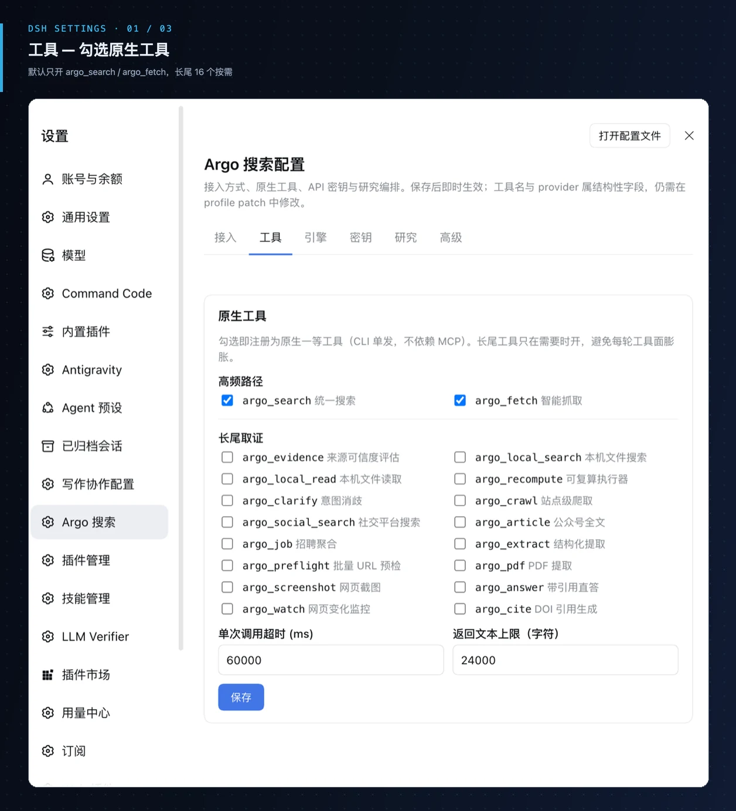
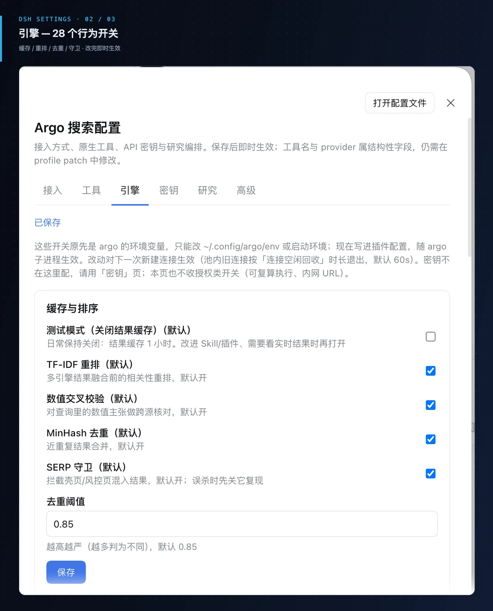
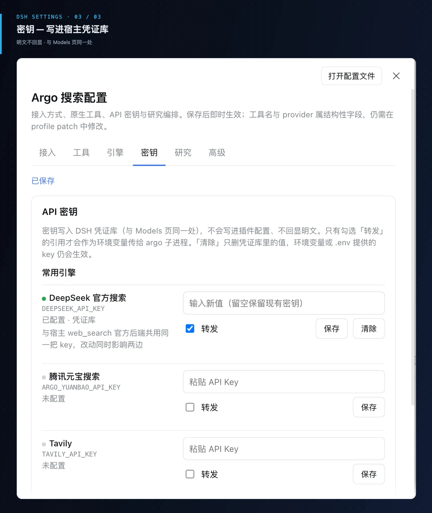

<p align="center">
  
</p>

<p align="center">
  <a href="README.md">中文</a> ·
  <a href="README.en.md">English</a> ·
  <a href="README.ja.md">日本語</a> ·
  <a href="README.ko.md">한국어</a> ·
  <strong>Español</strong>
</p>

<p align="center">
  <a href="#qué-es">Intro</a> ·
  <a href="#por-qué-supera-a-la-búsqueda-del-modelo-la-búsqueda-ia-y-el-metasearch">Comparar</a> ·
  <a href="#enrutamiento-según-la-consulta">Prueba</a> ·
  <a href="#cómo-funciona">Mecanismo</a> ·
  <a href="#inicio-rápido">Inicio rápido</a> ·
  <a href="#capacidades">Capacidades</a> ·
  <a href="#instalación-y-configuración">Config</a> ·
  <a href="#actualizaciones-recientes">Actualizaciones</a>
</p>

<p align="center">
  
  
  
  
  
</p>

> **Este repositorio es parte del conjunto de plugins DeepSeek Harness de taxueseek** ([dsh-files](https://github.com/taxueseek/dsh-files) 39★). Serie de habilidades del mismo autor: [session-digger](https://github.com/taxueseek/session-digger) 29★ · [taxue-invest](https://github.com/taxueseek/taxue-invest) 21★ · [taxueskills](https://github.com/taxueseek/taxueskills) 23★ · [taxue-creative-style](https://github.com/taxueseek/taxue-creative-style) 12★

# Argo: búsqueda e investigación profunda para agentes

## Qué es

**Argo es una herramienta de búsqueda e investigación profunda que vive dentro del agente, y también puede obtener información de las páginas web relevantes. Detrás tiene 272 fuentes de búsqueda que cubren 97 dominios de negocio, además de búsqueda básica sobre archivos locales. Entre los proyectos de búsqueda de código abierto, su capacidad de búsqueda es muy potente.**

Permite configurar claves API para mejorar la calidad de búsqueda (las fuentes con clave suelen dar mejores resultados; si falta la clave, se omiten automáticamente), y también cuenta con motores gratuitos y locales como red de seguridad automática. Cubre 18 idiomas, entre ellos chino, inglés, japonés y coreano, y da soporte a escenarios verticales como finanzas, academia, cine, deportes, código y macroeconomía.

## Sub-habilidades

Las capacidades de Argo se organizan en cuatro sub-habilidades, y cada una es un pipeline independiente que se puede usar por separado:

| Sub-habilidad | Capacidad |
|---------------|-----------|
| **local-search** | Búsqueda de archivos locales + agregador local de coste cero (32 motores locales). Busca símbolos de código, nombres de archivo, texto completo de documentos y estructura de archivos. Puede fusionarse con los resultados web: con un interruptor, los aciertos locales se unen a la misma búsqueda |
| **local-seek** | Búsqueda semántica local (BM25 + vectores híbridos) sobre notas, memoria y bases de conocimiento. Tres niveles progresivos: primero ubica el archivo, luego revisa el contexto y al final lee en detalle el pasaje |
| **ego-search** | Búsqueda profesional con sesión iniciada. Para contenido que exige login, como Zhihu, Xiaohongshu o cuentas de WeChat, usa un navegador real con la sesión activa. Desactivado por defecto; se activa cuando hace falta |
| **js-run** | Ejecuta JS de páginas web sin navegador. Corre scripts de página del tipo «detección de entorno + cálculo puro» sin abrir un navegador; P50 de contexto por ejecución: ~1 ms |

Las cuatro sub-habilidades cubren la cadena completa, desde buscar en la máquina hasta buscar en toda la web y detrás de muros de login. En la mayoría de casos basta con local-search + búsqueda en red; para escenarios especiales se activan ego-search y js-run.

## Plugin DSH

Argo también es un plugin de DeepSeek Harness: se instala con una sola línea.

```bash
dsh plugin --profile web add "github:taxueseek/argo"
```

Tras instalarlo, reinicia `dsh web` y queda activo. La búsqueda y el fetch pasan a ser herramientas nativas de primera clase: no dependen de una conexión MCP ni ocupan contexto permanente. Además hay 1 `wide_research` de investigación en paralelo y 19 herramientas MCP que se activan bajo demanda. Las formas de integrarlo están más abajo.

### Tres canales de invocación, un mismo conjunto de capacidades

El mismo núcleo de recuperación de argo (mismos motores, misma compresión, mismas guardas) abre tres canales dentro de DSH. Degradan automáticamente según la capacidad del host y se respaldan entre sí:

| Canal | Por defecto | Qué hace |
|-------|-------------|----------|
| **Herramientas nativas de primera clase** | Activado | `argo_search` / `argo_fetch` y demás se registran con `ctx.tools.register` y se ejecutan como disparos únicos de CLI (`--call`), reutilizando la pila de motores y guardas exacta que usa MCP — **sin conexión MCP y con coste de tokens residentes cero** |
| **Web seam nativo** | Activado | Registra `argo` como proveedor tanto de búsqueda como de fetch, de modo que el `web_search` integrado del host se enruta a la cadena de motores de argo y el `web_fetch` a su cadena de fetch (HTTP primero, con escalado automático a un navegador anti-detección en páginas con Cloudflare / renderizado JS) |
| **Forma MCP** | Bajo demanda | La superficie completa de 19 herramientas `mcp__argo__*`. Las definiciones de herramientas se inyectan en el contexto en cada ronda y sobreviven a la compactación (≈3.7K tokens/ronda medidos para 19 herramientas), y la ruta caliente ya está cubierta por las herramientas nativas y el web seam — por eso no se monta por defecto. Descomenta la línea `mcp-argo` del profile patch cuando necesites las herramientas de forense de cola larga |

Hay además un `wide_research`: planifica pistas complementarias (`depends_on` las escalona, en paralelo por defecto) → recolección de evidencia con subagentes concurrentes acotados → un libro de fuentes (solo se registran URLs http(s)) → un informe de síntesis. La salida lleva `quality_gate_results` (`conclusion_cap`: low/medium/high); cuando `passed=false` se rebaja el tono y se verifican las fuentes del libro antes de cualquier conclusión. La lista de permitidos de herramientas de evidencia del worker escribe tanto nombres MCP como nativos (semántica allow), así que funciona con o sin MCP montado: con MCP usa la superficie completa, sin él cae a `argo_search` / `argo_fetch` y al `web_search` / `web_fetch` del host.

Para una pregunta cotidiana usa `argo_search`; para forense con un solo agente usa `argo_research`; para comparación multiperspectiva con libro de citas usa `wide_research`. Los workers solo pueden llamar a herramientas de evidencia de argo por defecto y no pueden volver a llamar a `argo_research` (protección dura: las anulaciones de usuario no funcionan).

### Página de ajustes integrada: seis secciones, efectiva al guardar

El plugin incluye una página de ajustes del lado del navegador con dos entradas: el elemento "Argo" del menú izquierdo del popup de ajustes (`Cmd+,`), o Ajustes > Plugins > Argo (una tarjeta de resumen del mismo panel: clic para abrir).

<p align="center">
  
</p>

<p align="center">
  
</p>

<p align="center">
  
</p>

| Sección | Qué controla |
|---------|--------------|
| **Acceso** | Interruptores del web seam `web_search` / `web_fetch`; comando y argumentos de entrada del motor (npx o `mcp_server.py` local); tiempos de espera de búsqueda/fetch, límite de cuerpo, recuperación de conexiones inactivas, conexiones concurrentes |
| **Herramientas** | Casillas para las 18 herramientas nativas de primera clase (por defecto solo `argo_search` / `argo_fetch`); tiempo de espera por llamada y límite de texto devuelto |
| **Motores** | Los interruptores de comportamiento del propio argo (antes variables de entorno, lista curada de 28: caché / reordenación TF-IDF / verificación cruzada numérica / deduplicación MinHash / guardia SERP, Jina / UA móvil / capa de fetch Parallel, capa de evidencia semántica, gracia de cobertura y anchura de cola, lista de motores activos, proxy, raíces de búsqueda local y lista de lectura permitida, calentamiento / registro de uso / pool de conexiones / TTL varios). Los de tipo interruptor se aplican al instante; los de número / texto / lista se guardan en grupo; las filas sin configurar muestran el valor por defecto de argo y se marcan como "default". Los interruptores de autorización (recompute, URLs intranet) quedan deliberadamente fuera del panel |
| **Claves** | Definir, actualizar y borrar claves de motores habituales; muestra "configurada / sin configurar + capa de origen (almacén de credenciales / entorno de arranque / .env) + estado de solo lectura", sin mostrar el texto plano; cada fila tiene una casilla Reenviar, equivalente a añadir el nombre de referencia a `keyRefs` |
| **Investigación** | límites de worker / pistas / fuentes por pista / tokens y directorio de salida de informes |
| **Avanzado** | listas allow / deny de herramientas del worker, lista de reenvío de credenciales |

Guardar surte efecto de inmediato (todo es configuración volátil): el conjunto de herramientas nativas se registra y se retira según las casillas; los tiempos de espera, la concurrencia y los límites de investigación se leen en la siguiente llamada; los interruptores de motores se escriben como `argoEnv` (un `KEY=VALUE` por línea) en el entorno del subproceso de argo y se aplican a la siguiente conexión nueva (las conexiones antiguas del pool se recuperan con `searchIdleMs`, 60 s por defecto). Los campos estructurales (`toolName`, `provider`, `searchProviderId`, `fetchProviderId`) no están en la página de ajustes: siguen yendo por el profile patch y necesitan reinicio.

**Seguridad de claves**: las claves se escriben en el almacén de credenciales de DSH (el mismo sitio que la página de Modelos) — nunca en la configuración del plugin, nunca en registros, nunca se muestran. La prioridad de resolución de credenciales es **capa de archivo almacenado > entorno de arranque > .env del proyecto > .env del hogar**: guardar en el panel (o en la página de Modelos) sobrescribe los valores antiguos del entorno de arranque, y el subproceso de argo toma la clave nueva en la siguiente conexión nueva; Borrar solo elimina el valor del almacén de credenciales, así que las claves aportadas por variables de entorno o `.env` reaparecen. La página de ajustes es solo una entrada de escritura para el dominio de credenciales: las lecturas las sigue haciendo el host en cada llamada.

**Clave oficial de DeepSeek, suministrada de forma nativa**: el motor `deepseek_search` de argo (el `api.deepseek.com/v1/tools/search` oficial, cuyos resultados traen niveles de autoridad / puntuaciones de rerank / fechas de publicación) **comparte una sola clave con el backend de búsqueda oficial de DSH**. El plugin la obtiene mediante el credential seam nativo de DSH, así que no hace falta configuración manual: la resolución es `ctx.get('credentials').resolve('DEEPSEEK_API_KEY')`, resuelta en cada llamada — tras rotar la clave en la página de Modelos web, la siguiente conexión nueva la usa, sin reiniciar el plugin. El plugin nunca lee archivos de claves, nunca escribe en disco, nunca registra; el valor de la clave llega al entorno del subproceso de argo solo en memoria, y ningún mensaje de salida o de error lo contiene. En hosts antiguos sin servicio de credenciales lo omite en silencio: ese motor se desactiva por falta de clave, y las otras 263 fuentes no se ven afectadas.

**El pin del web seam es lectura obligatoria** (un pin ausente rompe `web_fetch`): la regla de selección de proveedor del host `dsh-web` es "gana el id configurado; si no hay ninguno configurado y exactamente uno está disponible, se elige; **si hay más de uno disponible, falla con `WEB_PROVIDER_AMBIGUOUS`**". El perfil web trae un proveedor http fetch oficial por defecto (sin clave, siempre disponible), y este bundle registra otro — así que sin pin hay dos disponibles y **`web_fetch` se rompe por completo** (igual con `web_search` si el perfil tiene otro proveedor de búsqueda). Cualquier perfil con el web seam activado debe especificarlo de forma explícita en la línea del servicio web:

```yaml
- id: web
  config:
    searchProvider: argo    # obligatorio cuando el search seam está activado (lo está por defecto)
    fetchProvider: argo     # obligatorio cuando el fetch seam está activado (lo está por defecto)
```

`searchProviderEnabled: false` / `fetchProviderEnabled: false` desactivan el web seam correspondiente por completo (el proveedor sigue registrado pero no seleccionable, y el otro no se ve afectado). En el lado de los motores, los motores de uso anónimo como Firecrawl funcionan **sin clave desde el primer momento** (cuota de capa gratuita), los motores con clave configurada se actualizan automáticamente a peticiones autenticadas, y una clave ausente no bloquea el enrutamiento.

> Las opciones de configuración completas, la tabla de versiones de Compatibility y los pasos de desinstalación están en [packages/dsh-plugin/README.md](packages/dsh-plugin/README.md).

## Ventajas principales

**272 fuentes, 235 disponibles sin clave desde el primer momento.** Funciona sin configurar ninguna clave API: los motores gratuitos y locales actúan como red de seguridad. Las fuentes con clave suelen ofrecer mejor calidad; si no hay clave, se omiten. Una instalación y cubres todos los escenarios.

**Búsqueda local y búsqueda web en una sola pieza.** Es una capacidad que solo tiene Argo. La búsqueda de archivos locales se apoya en las herramientas que los desarrolladores usan a diario, como rg y mdfind, y busca símbolos de código, nombres de archivo, texto completo de documentos y estructura de archivos. Con un interruptor, los aciertos locales se integran en la misma búsqueda web, marcados como archivos de la máquina. Cuando escribes y recuerdas que hace medio año anotaste algo pero no dónde, esto es más rápido que navegar carpetas.

**Caché de dos capas, consultas calientes en ~10 ms.** El contenido que no cambia tanto (enciclopedia, datos históricos) entra en caché tras la primera consulta; después, la misma consulta se resuelve al instante sin volver a recorrer la API. Ahorra dinero y tiempo.

**Multilingüe + escenarios verticales.** Probado en 18 idiomas: en chino, inglés y japonés se llega a fuentes primarias locales. Para papers, bibliotecas académicas; para cine, bases de datos de títulos; para código, comunidades de preguntas y respuestas; para mercados, fuentes financieras. Solo las preguntas genéricas van a búsqueda general.

## Instalar y usar

Funciona sin configuración. Tres formas de instalarlo, elige la que te acomode:

**Si quieres que tu asistente de IA sepa buscar por su cuenta**, instala el paquete de habilidades en su directorio de skills. Cuando le digas «búscame esto» o «verifícalo», irá a buscar solo.

**Si solo quieres probarlo**, un comando npx y listo, sin instalar nada.

**Si quieres que el asistente lo tenga siempre disponible**, conéctalo por MCP y tendrás 19 herramientas de búsqueda a mano. También hay un comando de inyección en un paso que configura automáticamente Claude Code, Cursor y Windsurf; Codex, OpenCode y Cline están en la misma lista. Antes de escribir la configuración hace una copia de seguridad, así que puedes revertir cuando quieras.

```bash
# Opción 1: script de instalación (recomendado para uso local a largo plazo)
curl -fsSL https://raw.githubusercontent.com/taxueseek/argo/main/scripts/install.sh | bash

# Opción 2: npx al paso (recomendado para montar el agente rápido)
npx -y github:taxueseek/argo

# Opción 3: git clone (desarrollo / modificar el código)
git clone https://github.com/taxueseek/argo.git
```

Una prueba rápida tras instalar:

```bash
argo search "python asyncio error handling"
```

Lo que devuelve son preguntas de la API oficial de StackOverflow ordenadas por puntuación de la comunidad y marcadas con el estado de respuesta aceptada, no un montón de granjas SEO.

Si quieres ver cuántas fuentes tienes disponibles en tu máquina ahora mismo, un comando las lista:

```bash
argo search --list-engines
```

## Formas de integración

Argo admite cuatro formas de integración; elige según tu caso:

| Forma | Ideal para | Descripción |
|-------|------------|-------------|
| **MCP Server** | Agente montado de forma permanente | 19 herramientas de búsqueda siempre disponibles; un comando las inyecta en Claude Code / Cursor / Windsurf / Codex / OpenCode / Cline, con copia de seguridad automática antes de escribir la configuración |
| **Plugin DSH** | Usuarios de DeepSeek Harness | Se instala con una línea de `dsh plugin add`; búsqueda y fetch pasan a ser herramientas nativas de primera clase, sin conexión MCP y sin coste de contexto permanente; incluye una página de ajustes de seis secciones efectiva al guardar |
| **Archivo Skill** | Claude Code / Grok Build / Kimi, etc. | El paquete de habilidades va al directorio de skills del agente; cuando dices «búscame esto» o «verifícalo», él busca solo |
| **npx al paso** | Probar rápido | `npx -y github:taxueseek/argo`, sin instalar; ideal para montar el MCP temporalmente en cualquier cliente |

Las cuatro formas comparten el mismo código Python por debajo; la CLI y las herramientas MCP se corresponden una a una, así que elijas la que elijas no pierdes capacidades.

## Por qué supera a la búsqueda del modelo, la búsqueda IA y el metasearch

> En corto: las tres primeras ayudan a **personas** a encontrar información. Argo ayuda a **agentes** a buscar y verificar en un mismo pipeline. La diferencia no es la interfaz, es el entregable: página de resumen o lista de enlaces para humanos frente a evidencia ordenable, re-verificable y que no hincha el contexto.

<p align="center">
  
</p>

| Dimensión | Búsqueda del modelo | Búsqueda IA (resúmenes) | Metasearch / motores | **Argo** |
|-----------|---------------------|-------------------------|----------------------|----------|
| Forma del resultado | Texto largo cosido | Página de resumen humana | Lista de enlaces SERP | **JSON compacto: candidatos de evidencia + desglose de credibilidad** |
| Preguntas verticales (cotizaciones / fórmulas) | Web genérica | Web genérica y luego resumen | Web genérica | **Fuentes verticales directas, en forma de respuesta** |
| Credibilidad de evidencia | Sin puntuación | Sin puntuación estructurada | Sin puntuación | **selection · absorption · freshness · consenso** |
| Consultas repetidas | Red cada vez | Red cada vez | Caché de página | **Caché de dos capas (memoria + SQLite); consultas calientes ~10 ms** |
| Control de coste | Incontrolable | Caro por llamada | Gratis pero trabajoso | **Modos de presupuesto; gratis primero; claves todas opcionales** |
| Multilingüe | Sigue al modelo | Sigue al modelo | Sigue al motor | **Detección de idioma + params de locale + enrutamiento multilingüe** |

> Mecánicamente, Argo trata la búsqueda como un **pipeline de evidencia**: detectar idioma → enrutar dominio → recall multi-motor → fusionar RRF → ojeada de evidencia. El agente puede ordenar, `fetch` para verificar y mantener el material dentro del contexto.

---

## Qué está cambiando en la búsqueda en 2026

1. **De enlaces a evidencia.** Los agentes necesitan material estructurado, verificable y compacto — Argo devuelve JSON con desglose de credibilidad.
2. **El contexto es el primer coste.** Argo perfil agente: ~3,7KB por llamada, con presupuestos de bytes fijados por gates.
3. **Los sitios preparan contenido para IA.** llms.txt y `.md` se extienden — la cadena de fetch los sondea en el nivel 0, con lector r.jina.ai como respaldo.
4. **El ecosistema libre basta.** APIs abiertas de gobiernos/academia/estándares/seguridad + motores sin clave cubren la mayoría de dominios (235 sin clave).
5. **Calidad medible.** Pisos golden de ranking, gates de ablación de fusión y controles negativos de enrutamiento.

> Los cinco puntos ya están implementados en la serie v2.9.x: 272 fuentes, 97 dominios, 235 sin clave.

---

## Enrutamiento según la consulta

<p align="center">
  
</p>

| Preguntas así | Lo que suele ocurrir |
|---------|----------------------|
| python asyncio error handling | Dominio de QA de programación → API oficial de StackOverflow/StackExchange, con puntuación y respuesta aceptada |
| AAPL / US pre-market | Dominio de acciones EE. UU., separado de A-shares |
| 肖申克的救赎 主演 / Inception director | Dominio cine → IMDb etc. |
| 梅西 俱乐部 / 库里 球队 | Dominio deportes → TheSportsDB etc. |
| 埃菲尔铁塔在哪 / where is Eiffel Tower | Entidad geo → OpenStreetMap etc. |
| NASA founding year / 国务院职能 | Entidad org → Wikidata etc. |
| 周杰伦 专辑 / Taylor Swift album | Dominio media → iTunes etc. |
| アニメ おすすめ / 한국 영화 추천 | Detecta JA/KO → fuentes amigables al idioma; evita sitios solo en chino |
| US CPI, inflación de Japón | Dominio macro; separa por país (fuentes nacionales primero) |
| log4j CVSS / nodejs 22 end of life | Seguridad → NVD oficial; ciclo de vida → endoflife.date |
| attention is all you need | Académico → metadatos de arXiv/OpenAlex/CrossRef con DOI |
| 阿司匹林 分子式 | Química → respuestas tipo PubChem |
| TSMC valuation debate (deep research) | Subpreguntas + fuentes en paralelo; verticales reforzados |

---

## Cómo funciona

<p align="center">
  
</p>

```
query
  ├─ intent clarify (optional)
  ├─ query rewrite (optional; routing still sees original intent)
  ├─ language detect + language preference
  ├─ route (domain rules + TF-IDF + budget + lang supplements + hot-path cache)
  ├─ multi-engine recall (circuit breaker / negative cache / parallel)
  ├─ staged empty-result recovery (widen → same family/general → cross-lang; anti-pollution)
  ├─ RRF fusion + optional re-rank
  ├─ evidence skim (authority · density · freshness · consensus)
  └─ unified JSON (incl. engine_outcomes / recovery)
```

### Puntuación de evidencia (resumen)

```
selection  ≈ domain authority; SERP / redirect shells ranked very low
absorption ≈ density of numbers / definitions / comparisons / disclosures
freshness  ≈ publish time (ignores historical comparison years like “since 2015”)
composite  ≈ 0.40·selection + 0.35·absorption + 0.15·freshness + 0.10·engine score
```

Los resultados incluyen `selection`, `absorption`, `credibility_fast`, `evidence_flags`, etc. para que el agente ordene directamente.

### Disciplina del agente (recomendada)

1. **Preguntas de alto riesgo** (posiciones, seguridad, «¿es cierto?»): buscar → leer puntuaciones rápidas → `fetch` de los top → luego concluir  
2. **Números**: declarar el计算方式 (definición/alcance); si las fuentes chocan, listarlas—no forzar fusión  
3. **Páginas SERP / redirección**: nunca como fuente primaria  
4. **Posts sociales**: sentimiento y narrativa, no verdad de fondo  
5. **Fact-check**: preferir pocas consultas estratificadas (fuente / comparación / sujeto)

---

## Inicio rápido

Elige cualquier camino. **GitHub es la única fuente de verdad de instalación** (`npx github:taxueseek/argo` o `install.sh`); recomendación actual **v2.9.7**. **No uses `npm install argo-search`** — la copia del registro npm es un **v1.0.1 no oficial y obsoleto** (no es este repo, incompleto, no se actualiza). Este paquete pone `private: true` para no publicarse en npm por error.

**Funciona sin configuración**: sin claves API corren motores gratis + `local_*` locales; los que requieren clave se omiten si faltan (y suelen mejorar cuando están).

### Opción 1: Script de instalación (mejor para uso local a largo plazo)

```bash
curl -fsSL https://raw.githubusercontent.com/taxueseek/argo/main/scripts/install.sh | bash
```

Home personalizado + enlace de Skill:

```bash
curl -fsSL https://raw.githubusercontent.com/taxueseek/argo/main/scripts/install.sh \
  | bash -s -- --home "$HOME/.local/share/argo" --link "$HOME/.claude/skills/argo"
```

Verificar:

```bash
python3 ~/.local/share/argo/scripts/search.py "python asyncio error handling" --json
python3 ~/.local/share/argo/scripts/search.py --list-engines
```

### Opción 2: MCP desde GitHub (enganche rápido del agente)

Necesita **Node.js 18+** y **Python 3.9+**. Una vez:

```bash
pip3 install pyyaml
```

```bash
npx -y github:taxueseek/argo
```

Config del cliente (Claude Code / Cursor / Kimi, etc.):

```json
{
  "mcpServers": {
    "argo": {
      "command": "npx",
      "args": ["-y", "github:taxueseek/argo"]
    }
  }
}
```

Más estable, sin Node: instala con la opción 1 y apunta a Python local:

```json
{
  "mcpServers": {
    "argo": {
      "command": "python3",
      "args": ["/path/to/argo/scripts/mcp_server.py"]
    }
  }
}
```

Ruta de Python inusual: `export ARGO_PYTHON=/path/to/python3` (solo lo lee la entrada npx).

### Plugin de una línea para DeepSeek Harness

Dos caminos dentro de DeepSeek Harness:

```bash
# A: 19 herramientas mcp__argo__* (bundle del paquete principal, igual que el MCP completo)
dsh plugin --profile web add "github:taxueseek/argo"

# B: herramientas de búsqueda + orquestación wide_research (subpaquete)
dsh plugin --profile web add "github:taxueseek/argo#main&path:packages/dsh-plugin"
```

Reinicia `dsh web` tras instalar. Ver `packages/dsh-plugin/`.

### Opción 3: Tarball de release

Abre [Releases](https://github.com/taxueseek/argo/releases) y descarga el tarball más reciente, **`argo-x.y.z.tar.gz`** (sustituye `x.y.z` por el número de la última versión):

```bash
tar -xzf argo-x.y.z.tar.gz
cd argo-x.y.z
pip3 install pyyaml
python3 scripts/search.py "Python asyncio" --json
python3 scripts/mcp_server.py
```

### Opción 4: git clone (dev / parchear fuente)

```bash
git clone https://github.com/taxueseek/argo.git
cd argo
pip3 install pyyaml
bash scripts/install.sh --link ~/.claude/skills/argo   # optional
python3 scripts/search.py --list-engines
```

### Opción 5: Directorio Skill (symlink, una sola fuente de verdad)

```bash
python3 scripts/link_source.py --to ~/.claude/skills/argo
python3 scripts/link_source.py --to ~/.agents/skills/argo

cp installs.local.yaml.example installs.local.yaml
python3 scripts/link_source.py
python3 scripts/link_source.py --check
```

### Opción 6: Biblioteca Python

```python
import sys
sys.path.insert(0, "/path/to/argo/scripts")
from search import super_search

result = super_search("Python asyncio", n=5, mode="fast")
for item in result["results"]:
    print(item["title"], item.get("credibility_fast"), item["url"])
```

```bash
# if bin/argo is on PATH
argo search "Python asyncio"
argo research "2026 mutual fund holdings structure"
argo evidence "a claim to verify"
```

---

## Plataformas

| Plataforma | Integración | Notas |
|----------|-------------|-------|
| **Claude Code** | MCP / enlace Skill | `npx` o `mcp_server.py`; `link_source.py` ok |
| **Kimi / Grok Build** | MCP Server | igual |
| **Cursor / Cline / Continue** | MCP | cualquier plugin IDE con MCP |
| **CLI** | `search.py` / `bin/argo` | scripts, cron, debug manual |
| **Proyectos Python** | `from search import super_search` | llamada de librería |

### Comprobación post-instalación

```bash
python3 --version          # 3.9+
python3 -c "import yaml; print('PyYAML OK')"
python3 -m pytest tests/test_unit.py -q   # optional
python3 scripts/search.py --list-engines
```

---

## Capacidades

| Capacidad | Qué hace | Entrada |
|------------|--------------|-------|
| Búsqueda unificada | route → recall → fuse → skim score | `search.py` / `argo_search` |
| Búsqueda de archivos locales | código/notas/memoria en disco (offline) | `argo_local_search` |
| Vista previa de texto local | preview en dirs en whitelist (fail-closed) | `argo_local_read` |
| Recompute | recálculo numérico en sandbox (niega por defecto) | `argo_recompute` |
| Investigación profunda | subpreguntas, multi-fuente, pistas de huecos | `research.py` / `argo_research` |
| Credibilidad | autoridad / densidad / frescura / cruce | `evidence.py` / `argo_evidence` |
| Aclarar intención | polisemia, colisiones de marca, pistas de estrategia | `clarify.py` / `argo_clarify` |
| Fetch de página | HTTP primero, navegador si hace falta | `argo_fetch` (`mode=extract` para estructura) |
| Captura / PDF | capturas de página, extracto PDF estructurado | `argo_screenshot` / `argo_pdf` |
| Crawl de sitio | crawl por lotes de páginas de listado | `argo_crawl` |
| Operadores de consulta | `site:` / `-site:` / `-término` / `-"frase"` / `"frase"` / `lang:` / `after:` / `before:` extraídos de ruta y recuperación (detalles en references/usage.md) | se escriben directo en la consulta |
| Señales de confianza | `authority_level` grado discreto (0-4, >=3 muy autoritativo) + `summary` resumen para Agent (se rellena tras verificar) | campos del resultado, visibles con `--fields agent` |
| Social / sentimiento | Weibo / Xiaohongshu / Bilibili / Reddit / X … | `argo_social_search` |
| Herramientas nativas DSH | al instalarlo como plugin DSH, `argo_search` / `argo_fetch` y demás pasan a ser herramientas de primera clase del host, ejecutadas como disparos únicos de CLI con coste de tokens residentes cero | llamar directo tras `dsh plugin add` |
| Web seam DSH | el `web_search` / `web_fetch` integrado del host se enrutan a las cadenas de motores y de fetch de argo (HTTP primero, con ascenso automático a navegador en páginas con Cloudflare / renderizado JS) | registrado por defecto por el plugin; fija `searchProvider` / `fetchProvider` en el perfil |
| Página de ajustes DSH | seis secciones — Acceso / Herramientas / Motores / Claves / Investigación / Avanzado — efectiva al guardar; las claves van al almacén de credenciales del host y nunca se muestran | popup de ajustes `Cmd+,` → menú izquierdo "Argo" |

### Modos de presupuesto

| Modo | Mejor para | Comportamiento |
|------|----------|----------|
| `fast` | Q simple, necesita velocidad | motores gratis primero; omite re-rank de pago |
| `auto` | default diario | equilibrio calidad/gasto con conciencia de coste |
| `deep` | investigación, sondeos | calidad primero; más motores |
| `budget` | cuota justa | control de cuota; degrada al agotarse |

### Conjunto aproximado de capacidades (v2.9.7)

Lo que hace Argo, en una frase: manda cada pregunta a las fuentes adecuadas según dominio e idioma, ordena lo que vuelve por credibilidad y devuelve al agente material que puede ordenar y verificar. Búsqueda, captura, verificación de evidencia y búsqueda de archivos locales comparten una sola tubería, 19 herramientas MCP se corresponden una a una con los comandos CLI, así que ninguna capacidad falta en la forma que instales. Algunos comandos sueltos completan el conjunto: argo tweet empaqueta un post de X, argo auth gestiona el estado de sesión y argo job agrega ofertas de empleo. El catálogo completo, con coste, clave y estado de cada fuente, está en docs/ENGINE_CATALOG.md: 272 fuentes, 235 sin clave, 97 dominios.

Instalado como plugin DSH, estas capacidades se convierten en herramientas nativas del host: la búsqueda y el fetch de la ruta caliente vienen activos por defecto, las herramientas de forense de cola larga se activan en la página de ajustes y los 28 interruptores de comportamiento del propio argo (caché, reordenación, deduplicación, guardia, proxy, TTL y demás) salieron de las variables de entorno para entrar en el panel. Las claves van al almacén de credenciales del host, nunca se muestran y todo cambio surte efecto al guardar.

Las últimas versiones arreglaron cada una una clase de problemas.

v2.9.7 arregló tres problemas antiguos. Cuando una IA dentro de un huésped DSH pedía leer una URL, el huésped usaba su propio capturador, así que redirecciones de enlaces cortos y páginas de desafío JS fallaban de forma estructural mientras la cadena de fetch de argo se quedaba sin uso; esta versión pasa las lecturas del huésped por argo, y esas páginas van de fallar a funcionar, sin cambios en las páginas estáticas. El pool de candidatos de enrutado contenía 18 motores de solo-uso-explícito, y si alguno se auto-seleccionaba el único motor de pago te facturaba en silencio; el pool está limpio ya, y usarlos requiere decirlo. Cada éxito de motor tomaba antes un bloqueo de fichero y reescribía el estado del breaker en disco; los motores sanos ahora cuestan cero E/S de ficheros y la contabilidad multi-motor se confirma en una sola transacción. La licencia también pasó de MIT a Apache-2.0, más cómoda para uso comercial.

Después de eso, el plugin DSH ganó otra capa: la página de ajustes pasó de cinco secciones a seis, la nueva sección «Motores» trae los interruptores de comportamiento de argo al panel (antes solo eran variables de entorno), la página de claves muestra ahora si cada clave viene del almacén de credenciales, del entorno de arranque o de `.env`, y los interruptores de herramientas, los tiempos de espera, la concurrencia y los límites de investigación se aplican todos al guardar. La cancelación también llegó a la etapa de establecimiento de la conexión: cuando la IA se detiene a mitad de camino, un subproceso de argo que aún se está creando se mata de inmediato en lugar de esperar a que expire su tiempo de espera.

v2.9.6 se ocupó de los operadores de consulta y la capa de transporte. Una consulta como site:github.com algo trataba antes su operador como una palabra normal, o lo analizaba sin aplicarlo nunca; una capa de contrato quita ahora los operadores antes de enrutar y cachear, aplica site: como filtro real y lo mete en la clave de caché, así dos búsquedas no se contaminan. En transporte, cada POST repagaba el saludo TLS, de 320 a 561 ms; con conexiones agrupadas, un proceso MCP residente lo ahorra en cada consulta. Esta versión también sumó el motor oficial de DeepSeek, facturado por llamada y fuera de los combos cotidianos.

v2.9.5 agregó tipos de cambio y limpió la deduplicación. Preguntar por el tipo USD/CNY daba antes vueltas por el dominio macro y acababa en una entrada de enciclopedia, 1,4 s sin respuesta; un dominio fx dedicado responde ahora en 675 ms con el tipo al contado y las noticias diarias. La deduplicación ganó normalización de sufijos de sitio y una segunda pasada difusa, así los documentos oficiales con separadores en el título dejan de caer al fondo.

v2.9.4 corrigió la ruta de motor explícito. Fijar --engine X tenía antes un TTL de caché uniforme; con la determinación de dominio en su sitio, el TTL sigue al dominio y la ausencia de motor de respaldo ya no provoca una reejecución vacía del mismo motor.

El detalle por versión está en «Actualizaciones recientes»; las notas de cada versión, en docs/.
---

## Motores y enrutamiento

La config tiene ahora **272** fuentes (**235** sin clave) y **97** dominios (ver `config.yaml` y `--list-engines`).

### Directos y verticales (extracto)

| Motor | Escenario | Sesgo de coste |
|--------|----------|-----------|
| anysearch / duckduckgo | general / tech | free |
| sina_quote / tencent_quote / eastmoney | cotizaciones A-share / flujos | free |
| finviz / seeking_alpha | finanzas EE. UU. y exterior | depends |
| imdb / itunes / thesportsdb | cine / música / deportes | mostly free |
| local_openstreetmap / wikidata / wikipedia | geo / org / enciclopedia | free |
| arxiv / semantic_scholar / openalex | académico | mostly free |
| pubchem / gbif / rfc_editor | química / especies / estándares | free |
| github / stackoverflow / pypi / npm | código y paquetes | depends |
| byted / bocha / metaso / octen / yuanbao | web china / búsqueda IA | API / bajo coste |
| hkex / shfe / cfets / defillama / gleif | anuncios de HKEX / SHFE / paridad central del yuan / DeFi / identificadores de entidad legal | Gratis |
| zhihu / wechat_sogou | opinión china / WeChat | API / free |
| tavily / felo / exa | internacional / semántica | paid or quota |
| twitter / reddit / xiaohongshu / bilibili / weibo | social UGC | free (some need login) |

### Capa local de coste cero (`local_*`)

No hace falta un servicio SearXNG aparte. La ruta principal usa parseo in-process de HTML / RSS / JSON (`local_bing`, `local_sogou`, `local_google`, `local_arxiv`, …). En **consultas multilingües**, el enrutamiento reescribe params de idioma del motor (p. ej. Bing `setlang`) y fusiona con RRF.

---

## Ejemplos

### Finanzas

```bash
python3 scripts/search.py "python asyncio error handling" --explain
# typical: stock_query → quote snapshot sources
```

### Académico

```bash
python3 scripts/search.py "transformer attention mechanism paper" --json
# domain often academic; combo includes arxiv etc.
```

### Investigar y verificar

```bash
python3 scripts/research.py "2026 mutual fund Q2 holdings structure" --depth deep --json

python3 scripts/search.py "same query" --json | \
  python3 scripts/evidence.py "same query" --stdin --json
```

### Herramientas MCP (12)

| Herramienta | Propósito |
|------|---------|
| `argo_search` | búsqueda unificada |
| `argo_local_search` | archivos locales (offline) |
| `argo_local_read` | preview de texto local en whitelist (fail-closed) |
| `argo_recompute` | recálculo en sandbox (niega por defecto; hace falta auth) |
| `argo_research` | investigación profunda (incl. modo sentimiento social) |
| `argo_evidence` | puntuación de credibilidad |
| `argo_clarify` | desambiguación de intención |
| `argo_fetch` | fetch inteligente (`mode=extract` extracto estructurado) |
| `argo_crawl` | crawl de sitio |
| `argo_screenshot` | captura de página |
| `argo_pdf` | extracto PDF |
| `argo_social_search` | social multi-plataforma (`mode=sentiment`) |

---

## Instalación y configuración

### Requisitos

| Ítem | Requisito |
|------|-------------|
| Python | 3.9+ (CLI + núcleo MCP) |
| Deps | `pip install pyyaml` (única dependencia dura) |
| Node.js | **solo** para entrada `npx`, 18+ |
| SearXNG | no requerido (motores locales integrados) |

### Claves API (todas opcionales)

Sin clave se omite ese motor; los gratis sostienen. **Usa variables de entorno**—nunca commits de claves reales ni pegarlas en issues.

```bash
# recommended (better quality)
export TAVILY_API_KEY="your_key"
export BOCHA_API_KEY="your_key"
export METASO_API_KEY="your_key"
export ZHIHU_ACCESS_SECRET="your_key"

# optional
export BRAVE_API_KEY="your_key"
export FELO_API_KEY="your_key"
export GITHUB_TOKEN="your_key"
export WEB_SEARCH_API_KEY="your_key"
export ANYSEARCH_API_KEY="your_key"
export OCTEN_API_KEY="your_key"
export ARGO_KEENABLE_API_KEY="your_key"   # opcional; prueba gratis de Keenable
```

`config.yaml` solo guarda placeholders `{ENV_NAME}`—sin secretos en claro en git.

### Caché

La ruta SQLite por defecto es `cache.db_path` en `config.yaml` (suele ser `~/.cache/unified-search/cache.db`).

| Tipo | TTL aprox. |
|------|-------------|
| Finance | ~5 min |
| News / realtime | ~10–15 min |
| General | ~1 hour |
| Research / evergreen | ~2–24 hours |
| Empty results | very short (avoid freezing “no hits”) |

### FAQ

**¿Funciona sin claves API?**  
Sí. Muchos motores locales gratis y APIs gratis; la ruta sin clave es automática.

**¿Script de instalación vs npx?**  
Script: instalación local fija, config, enlace Skill. npx: enganchar MCP rápido. Mismo núcleo Python.

**¿Cómo ver los motores?**  
`python3 scripts/search.py --list-engines`, o añade `--explain`.

**¿Varias copias de código en el repo?**  
No. Prefiere una fuente + symlinks con `link_source.py`, no clones rsync.

---

## Flags CLI

```
python3 scripts/search.py [options] query

  --engine, -e       engine, default auto
  --max-results, -n  count, default 5
  --depth, -d        fast | balanced | deep
  --mode             fast | auto | deep | budget
  --no-cache         skip cache
  --explain          print routing explanation
  --json             JSON output
  --timeout, -t      timeout seconds
  --list-engines     list engines
```

---

## Compromisos de diseño

1. **Absorción del agente primero, cantidad de enlaces segundo.**  
2. **Gratis y local primero; de pago es elevación opcional.**  
3. **Los fallos son observables**: empty / timeout / breaker van etiquetados—sin tragar en silencio.  
4. **Motores guiados por config**; `config.yaml` es la única fuente de verdad.  
5. **Instalación de fuente única**: enlaza entradas, no rsync de copias.  
6. **Lo social no es una biblioteca de verdad**; sirve para expansión y sentimiento, no como única base factual.

---

## Buenos encajes

- Backend de búsqueda para agentes Claude Code / Grok Build / Codex / Kimi  
- Q&A **multilingüe y multi-dominio**: CJK + EN + finanzas / cine / deportes / academia / código  
- Scripts y pipelines que necesitan recuperación **reproducible y cacheable**  
- Fact-check y comparación multi-fuente de datos públicos de finanzas / entidades  

No es gran solución única para: ranking nativo de engagement de plataforma, o agregadores max-recall de larga vida (los motores locales embebidos reemplazan SearXNG externo como vía principal).

---

## Árbol (resumen)

```
argo/
├── README.md                # Chinese (default)
├── README.en.md             # English
├── README.ja.md             # Japanese
├── README.ko.md             # Korean
├── README.es.md             # Spanish
├── SKILL.md
├── package.json             # npx entry
├── bin/argo.js              # Node MCP launcher
├── bin/argo                 # Python CLI
├── config.yaml              # engines & domains (source of truth)
├── assets/readme/           # README visuals
├── backends/
├── mcp/                     # fuente de inyección MCP multi-cliente (clients.yaml)
├── scripts/                 # search / research / mcp / install …
├── sub-skills/local-search/
├── sub-skills/ego-search/      # búsqueda profesional con sesión (off por defecto)
├── tests/
└── docs/
```

---

## Actualizaciones recientes

Solo las tres versiones más recientes. El historial completo está en el [historial de cambios](#historial-de-cambios) y el detalle de cada versión en [Releases](https://github.com/taxueseek/argo/releases).

### Próxima versión: búsqueda de Tencent Yuanbao + tres fuentes más sin clave + lista estructurada de fallos

- **Búsqueda de Yuanbao**: fuente china de primera mano y voz oficial, complementaria a la mezcla de portales y autopublicaciones de bocha y byted; ocupa el 2.º puesto del dominio general chino como cobertura de autoridad. Clave: `ARGO_YUANBAO_API_KEY`
- **Tres fuentes más sin clave**: `tavily_free`, `keenable_free` y el retorno anónimo de `exa` funcionan sin configurar ninguna clave
- **Fallos sobre los que se puede actuar**: cada fallo indica su origen y su clase, y dice si reintentar, cambiar de fuente o configurar una clave, junto a un nivel de confianza `meta.uncertainty`
- **Capa de configuración local `config.local.yaml`**: los ajustes de esta máquina ya no se escriben en la configuración pública que acompaña a cada versión
- **Nueva sección «Engines» en la página de ajustes de DSH**: los 28 interruptores de comportamiento de argo salen de las variables de entorno y pasan al panel

### v2.9.7: consolidación de arquitectura + el host delega la obtención de páginas en argo + License pasa a Apache-2.0

- **Cambio de License**: MIT → Apache License 2.0. Se explicita la concesión de patentes; lo demás no cambia
- **Las páginas que el host no podía obtener ahora sí se obtienen**: acortadores, actualizaciones de protocolo, redirect shells y páginas con desafío de JS pasan por la cadena de fetch de argo (HTTP primero, con escalada automática a un navegador cuando el sitio se resiste). Activado por defecto; se desactiva con `fetchProviderEnabled`
- **El modo auto ya no llama por error a motores de pago**: los 18 motores exclusivos de invocación explícita salen del pool de candidatos de enrutado y solo se usan si se nombran con `--engine`
- **Una clave nueva recupera el siguiente salto**: los motores con cuota agotada ya no esperan a que venza su ventana de recuperación, y la caché de enrutado se recalcula
- **Ejecutar JS desde crawl / research / MCP ya no se cae**

### v2.9.6: DeepSeek Search + operadores de consulta + fin del doble pago del mismo POST

- **Nuevo motor `deepseek_search`**: 445-510 ms, el único de los tres que cubre clasificación de autoridad, rerank_score y fecha de publicación; `--since/--until` funciona de verdad. Se factura por llamada y requiere su propia `DEEPSEEK_API_KEY`; sin clave se omite
- **Operadores de consulta bajo un solo contrato**: `site:` / `-site:` / `-término` / `lang:` / `after:` / `before:` se analizan de forma uniforme, y `site:` aplica un filtrado posterior real
- **El mismo POST ya no se paga dos veces**: la reutilización del pool de conexiones ahorra 320 ms (anysearch) / 561 ms (octen) en la segunda petición de una misma conexión
- **Dos defectos de enlaces y ordenación corregidos**: todos los resultados de un motor puntuaban igual y aplanaban la salida; los redirect shells de Bing sin restaurar costaron sus resultados al 40,2 % de las consultas en 7 días
- **Las decisiones de enrutado tienen puerta de instantánea**: una inversión de rutas se vuelve un golden diffeable en lugar de cambiar en silencio

---

## Historial de cambios

| Versión | Notas |
|---------|-------|
| **v2.9.7** | **Consolidación de arquitectura + seam web_fetch DSH + License a Apache-2.0**: MIT → Apache License 2.0; el web_fetch del huésped ahora fluye por la cadena argo_fetch (HTTP primero, ascenso a navegador ante desafíos JS, ejecución de doble vía, sin reenvío en errores de herramienta, fallos en cinco clases); 18 motores explicit_only fuera del pool de candidatos de enrutado (cierra el agujero de facturación accidental de motores de pago en auto); cortocircuito de salud del breaker, contabilidad adaptativa de una transacción, desbloqueo automático de cuota al rotar clave, invalidación de caché de ruta por agotamiento; auto/deep descartan motores agotados + early-stop más amplio + agrupación de conexiones POST; js-run arregla el crash fuera del hilo principal. |
| **v2.9.6** | **Motor DeepSeek Search + contrato de operadores de consulta + agrupación de conexiones + puerta de instantáneas de enrutado**: nuevo motor `deepseek_search` activo por defecto (se omite sin key; 445-510ms, el único con cobertura completa authority/rerank_score/hora, ventanas de tiempo realmente efectivas; DSH comparte la key por el seam nativo de credenciales); `site:`/`-site:`/`-término`/`lang:`/`after:`/`before:` convergen en una capa de contrato con posfiltrado real + entrada en clave de caché; agrupación de conexiones POST (ahorra 320-561ms por petición) + preconexión MCP; octen entra en fallback y cobertura (p90 3273→1614ms, escapatoria `ARGO_GENERAL_FALLBACK_LEGACY=1`); corrige decadencia de rango RRF y caparazón de redirección Bing (40.2% de vacíos); nuevas puertas pre-commit y de instantáneas de enrutado; plugin DSH se adapta al doble stack 0.2.1-rc.2 + cobertura unit de alpha.1. |
| **v2.9.5** | **Dominio dedicado de tipo de cambio + deduplicación de dos capas + corrección de falsa penalización + aislamiento de daemon por checkout**: nuevo dominio `fx_query` (tipo/paridad: en vivo + noticia diaria en 675ms vs enciclopedia antes); dedup gana normalización de sufijo (cero dependencias) + revisión difusa rapidfuzz (opcional, `ARGO_DEDUP_FUZZY`, con vuelta atrás); corrige ×0.6 por separadores (docs oficiales de vuelta arriba); negación gana "no-X"; nombres de daemon acotados por checkout. |
| **v2.9.4** | **Atribución explícita de dominio de motor + cortador de cadena de recuperación + sincronización de puertas**: `--engine X` complementa `match_domains` corrigiendo TTL de caché general; motor único sin alternativa omite ejecución vacía L1; reglas `config.yaml` mejoradas; exportación `mcp_launch.sh` reducida; capa de registro local cerrada y calidad mejorada; sincronización de puertas. |
| **v2.9.3** | **Empaquetado completo de posts de X + carril de estado de sesión del navegador + calidad/velocidad de la cadena local**: nuevo `argo tweet` (texto completo/hilo/citas/retweets/medios empaquetados bajo demanda, paquete de 4 archivos con `--out`); nuevo carril de sesión de navegador `argo auth` (perfil persistente por sitio, cookies solo en el almacenamiento cifrado de Chrome, resultados con sesión excluidos de la caché compartida); la cadena local china resuelve shells de Sogou/Baidu sin sesión (conservados 1→5) + gracia de consenso adaptativa (despacho en inglés ~3.0s→2.2-2.5s); js-run como primer carril de la cadena de fetch (reintentos con huella Chrome); consultas ferroviarias con transbordo/escala (embudo 10→1 corregido a un fiel 10→10); `--academic-deep` búsqueda académica profunda con una bandera; 43 motores conectados a dominios + 3 fuentes financieras sin clave + corrección del bloqueo falso de intención; huellas de imagen local 158ms→3.9ms; adelgazamiento del consumo por agentes (overhead fijo MCP −32%). |
| **v2.9.2** | **Compatibilidad verificada con DSH 0.2.1-alpha.1 + tanda de correcciones de enrutamiento/guardas + sub-skill js-run**: las tres formas del plugin DSH verificadas en el último DSH 0.2.1-alpha.1; `argo mcp inject` añade WorkBuddy, cubriendo el 7.º host; degradación de evidencia débil TF-IDF a fuentes auxiliares, piso de fuentes muertas + relleno de slots del breaker, aislamiento de enrutamiento de motores con cuota agotada, corrección de falsos positivos en cascada de serp_guard; importaciones diferidas de engines/evidence (import −50%) y cortocircuito del conjunto de existencia en admisión (open 261→99); guardas de entrada MCP y de argumentos numéricos cerradas; nueva sub-skill js-run (JS web sin navegador, P50 ≈1ms). |
| **v2.9.1** | **Optimización de calidad de contenido + resistencia a granjas de contenido + adaptación a la última versión**: evaluación de calidad de contenido mejorada, con mayor capacidad de identificar y filtrar contenido de baja calidad generado en masa; adaptación a la última versión para una colaboración sin fisuras; la búsqueda local añade una guarda de su propio árbol de instalación para evitar que los resultados se contaminen con su propio código fuente. |
| **v2.9.0** | **Optimización de fuentes + paridad plugin/CLI + lenguas minoritarias**: fuentes 237→253 (sin clave 198→219); se añaden 14 fuentes de noticias en lenguas minoritarias, la fuente de texto completo CORE, TinEye de búsqueda inversa de imágenes, Bing RSS y más; Baidu y Sogou revividas; 18 comandos CLI corresponden uno a uno con 19 herramientas MCP; cadena de importación −79%, rerank 33ms→1.5ms, aciertos de caché notablemente mejorados; corrección de seguridad entre procesos en la ruta de escritura de cuotas; nuevo registro de uso local `argo stats`. Ver [notas de la versión](docs/RELEASE_NOTES_v2.9.0.md) |
| **v2.8.9** | **Salida más ligera + recuperación más rica y rápida + 5 fuentes internacionales y de verificación**: salida por defecto 15.5KB→5.2KB (−66%, `--envelope` restaura el sobre completo); la caché de decisiones de enrutado reduce las consultas repetidas −30%; despacho en red lenta −36% (dominios serie con respaldo automático tras 0.8s); revisión de la cadena de fetch en cinco rondas (recall +35%, latencia −30%, P90 de cola larga −8%) + restauración de estructura del cuerpo (títulos/listas/tablas 0/6→6/6) + corrección de la puntuación de calidad para CJK; nuevas fuentes sin clave Guardian RSS / France 24 / DW / FactCheck.org / Full Fact (235→237, sin clave 194→198, dominios 90→92), gdelt retirado; seis defectos de autoconsistencia corregidos + embudo de seis etapas + herramienta de repetición sin conexión (`scripts/replay_eval.py`) + puertas de despliegue post-política y contratos de umbral por escenario. Ver [notas de la versión](docs/RELEASE_NOTES_v2.8.9.md) |
| **v2.8.8** | **Correcciones reportadas por usuarios reales (#12 silencio del alias de clave, #13 fetch sin proxy) + aceleración general + fuentes 218 → 235**: despacho de salida unificado (`ARGO_PROXY` / reglas por dominio / variables de proxy estándar, respetando `NO_PROXY`); 16 puntos de lectura de claves unificados en la cadena de alias; arranque en frío 2.1s→0.55s, caché de configuración 50–82ms→16–18ms, parada temprana con umbral de planitud QPP, `--list-engines --detail` reducido 152KB→51KB; nuevos `argo answer` (respuestas directas con citas) y `argo watch` (detección de cambios web), 14 fuentes sin clave (tendencias y vida diaria de China / avisos de seguridad / académico de acceso abierto / directorios de skills / búsqueda para agentes), 69 motores reclasificados (cuota del fallback `web_general` 41%→20%, nuevo dominio security); rutas convencionales por plataforma (`argo paths`) + Python 3.9 + concurrencia acotada que hace efectivos los timeouts; search.py dividido en módulos 3351→2526 líneas, golden de relevancia sobre 22 motores, puertas de defectos estáticos y de contrato de salida. Ver [notas de la versión](docs/RELEASE_NOTES_v2.8.8.md) |
| **v2.8.7** | **218 fuentes / 89 dominios + tres canales de salida directa del cuerpo + disciplina de disparo de rutas + corrección de cero resultados en macro**: 50 fuentes nuevas acumuladas en los lotes 7/8/9 (leyes, estándares, inteligencia de seguridad, academia, noticias, entretenimiento, energía/transporte, legal/administrativo), motores stackexchange y doi; sondeo de nivel 0 llms.txt y variantes `.md` en la cadena de fetch, más nivel lector r.jina.ai; corrección de la lista de motores separada por comas en `--engine`, alcance de tfidf y route_reason, matriz de control de rutas negativas, golden de ranking y puertas de ablación de fusión; las consultas macro de China priorizan el buró nacional de estadística, la recuperación de cero resultados abre L3 y los motores de rescate se contabilizan con honestidad. Ver [notas de la versión](docs/RELEASE_NOTES_v2.8.7.md) |
| **v2.8.6** | **Carrera hedged + reparto de tres fuentes de Zhihu + despacho declarativo por idioma + puerta de alcanzabilidad + protocolo de búsqueda académica**: carrera con ventana de gracia para el primer motor (los motores rápidos pagan 1 llamada), búsqueda global y datos personales de Zhihu con antiexterminio, despacho por idioma/académico de subconsultas (fuentes en inglés y 17 fuentes académicas en la recolección), metadatos de idioma por motor y puerta de alcanzabilidad (las fuentes muertas salen a la luz), cola geo −56%, protocolo de construcción de consultas académicas. Ver [notas de la versión](docs/RELEASE_NOTES_v2.8.6.md) |
| **v2.8.5** | **Herramientas nativas del plugin DSH + MCP apagado por defecto + compatibilidad Windows + autocuración de cuotas + deadline de fetch**: `argo_search`/`argo_fetch` como herramientas nativas de primera clase (CLI de un tiro, mismo motor y guardas que MCP, esquema de fuente única + puerta contra deriva); tres formas de conexión, MCP a demanda; compatibilidad Windows (rutas temp / GBK / resolución de intérprete / junction / `install.ps1`, PR #11); bucle de autocuración de cuotas (detección de sobre HTTP 200 + exclusión de ruta + autocuración por periodo); deadline global de fetch (`ARGO_FETCH_DEADLINE_S`) + renderizado tinyfish + sondas `.md`; env de recarga caliente y directorio de estado de fuente única. [Notas](docs/RELEASE_NOTES_v2.8.5.md) |
| **v2.8.4** | **Fusión de datos locales + inyección MCP multi-cliente + búsqueda estructurada + Keenable**: investigación L1 con datos locales de primera mano (`file_inputs` + `recompute` + `local_sources`); `argo mcp inject` (`mcp/clients.yaml` declarativo); normalización / variantes / puerta de complejidad / sintaxis social primero / arreglo TF-IDF / `--include-local`; motor Keenable (prueba gratis); endurecimiento de seguridad. Ver [notas de release](docs/RELEASE_NOTES_v2.8.4.md) |
| **v2.8.3** | **Arreglo de enrutamiento multilingüe + anysearch in-process + RRF ponderado**: ja/ko devuelven el idioma objetivo; DE/FR/ES/IT vía anysearch; downweight weakest-link (paper 2508.01405). Ver [notas de release](docs/RELEASE_NOTES_v2.8.3.md) |
| **v2.8.2** | **Windows + semántica de evidencia unificada**: se quita el límite npm `os`; UTF-8 contra cuelgues GBK; `dsh.bundle` en el paquete principal; puerta de calidad de `wide_research`. Ver [notas de release](docs/RELEASE_NOTES_v2.8.2.md) |
| **v2.8.0** | **Bucle de evidencia + empleos v3 + clima dual**: `fetch_required` / `--verify`; `argo job`; wttr.in + Open-Meteo; Parallel / You.com. Ver [notas de release](docs/RELEASE_NOTES_v2.8.0.md) |
| **v2.7.3** | HttpClient en capa de motor; TF-IDF activa 25 verticales; TTL de 70 dominios; verticales bilingües. Ver [notas de release](docs/RELEASE_NOTES_v2.7.3.md) |
| **v2.7.2** | Búsqueda profesional con sesión (ego-search, off por defecto); JA/KO ya no mezclan motores chinos. Ver [notas de release](docs/RELEASE_NOTES_v2.7.2.md) |
| **v2.7.1** | Endurecimiento SSRF + arreglo del estado de salud del routing. Ver [notas de release](docs/RELEASE_NOTES_v2.7.1.md) |
| **v2.7.0** | **Tarjetas modales verticales estructuradas**: motores nativos `bocha` / `bocha_ai` integrados; el dominio `modal_card` reconoce en un solo lugar tarjetas en tiempo real — billetes de tren / precios de combustible / metales preciosos / calendario perpetuo / horóscopo / consulta de teléfono / vehículos / citas médicas, etc.; corregido un defecto de análisis web de `bocha`. Ver [notas de la versión](docs/RELEASE_NOTES_v2.7.0.md) |
| **v2.6.2** | Fusión de líneas de mejora independientes: conciencia del entorno de red / RRF ponderado + caché semántica / desactivación adaptativa de motores / seguridad de contenido + variantes de consulta / tres grandes motores verticales / mejora del enrutamiento de dominios ja-ko; incluye la corrección de enrutamiento de v2.6.1. Ver [notas de la versión](docs/RELEASE_NOTES_v2.6.2.md) |
| **v2.6.1** | Versión de corrección de v2.6.0: corrección de daño colateral de enrutamiento (`capital of` ya no se apodera de fact_check); sincronización de versión. Ver [notas de la versión](docs/RELEASE_NOTES_v2.6.1.md) |
| **v2.6.0** | **Búsqueda multilingüe** (detect / engine params / cross-lang fallback); verticales film·sports·geo·org·media; recovery anti-contaminación; familias de capacidad + regresión matrix; ~120+ fuentes. Ver [notas de release](docs/RELEASE_NOTES_v2.6.0.md) |
| **v2.5.1** | Fuentes de respuesta finanzas/macro/química más densas; tiers de motor + presupuesto combo; [notas v2.5.1](docs/RELEASE_NOTES_v2.5.1.md) |
| **v2.5.0** | Script de instalación + npx; rewrite desacoplado del routing; caché hot-path; MCP compacto |
| **v2.4.0** | Fallback de ruta de baja puntuación + filtros de mal-enrutado social; caché depth / soft hits; breakers y caché negativa; `engine_outcomes` |
| **v2.2–v2.3** | Evidencia en dos etapas, tabla de fuentes chinas, content_signals, stack fetch, más motores |
| **v2.1** | Capa de motores sociales (UGC multi-plataforma) |
| **v1.x** | Nombre unificado Argo; enrutamiento multi-motor + caché de dos capas |

---

## Contribuir

Issues y PRs bienvenidos. Si cambias lógica de routing o evidencia, añade tests:

```bash
python3 -m pytest tests/test_unit.py tests/test_multilingual.py -q
python3 scripts/regression_p0p1.py --offline
python3 scripts/matrix_search_eval.py --offline
python3 scripts/ab_eval_p0p1.py   # optional, online
```

Antes del commit: sin claves API reales, rutas absolutas de máquina ni cookies de cuenta. Las rutas locales de Skill van en `installs.local.yaml` (gitignored).

## License

Apache License 2.0 © 2026 [taxueseek](https://github.com/taxueseek)

<p align="center">
  <a href="https://github.com/oil-oil/beautify-github-readme"></a>
</p>

---

> Una buena búsqueda no es ver más: es concluir con confianza, y saber cuándo aún no debes.
